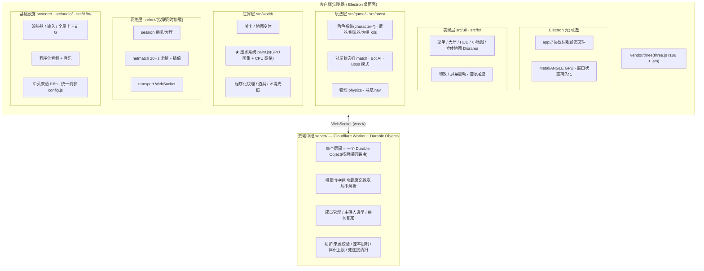

# INKWAVE 技术架构

> 一份面向开发者/贡献者的架构解读。配套阅读:[CONTRACTS.zh-CN.md](CONTRACTS.zh-CN.md)(模块约定与美术方向)、[NET.zh-CN.md](NET.zh-CN.md)(联网协议契约)。
>
> **一句话概括**:基于 **three.js r186** 的纯浏览器 4v4 喷射射击游戏,零构建、零打包器(原生 ES Modules + Import Map),所有美术资产程序化生成,联网采用 **Cloudflare Durable Object 中继 + 客户端权威模拟** 的架构。

---

## 1. 整体架构图



等价的纯文本视图:

```
┌─────────────────────────────────────────────────────────────────────┐
│  客户端 (浏览器 / Electron 桌面壳)                                     │
│                                                                     │
│  ┌────────────────────────────────────────────────────────────┐     │
│  │  Electron 壳 (electron/main.cjs) — 可选                      │     │
│  │  app:// 协议伺服静态文件 + Metal/ANGLE GPU + 窗口状态持久化    │     │
│  └──────────────────────┬─────────────────────────────────────┘     │
│                         │                                            │
│  ┌──────────────────────▼─────────────────────────────────────┐     │
│  │  表现层  src/ui/   src/fx/                                   │     │
│  │  菜单/大厅/HUD/小地图/立体地图(Diorama)  特效/屏幕震动/游泳尾迹   │     │
│  ├────────────────────────────────────────────────────────────┤     │
│  │  玩法层  src/game/  src/boss/                                │     │
│  │  角色系统(character-*)  武器/副武器/大招(kits)  物理/导航        │     │
│  │  对局状态机(match)  Bot AI(bots)  Boss 模式                  │     │
│  ├────────────────────────────────────────────────────────────┤     │
│  │  世界层  src/world/                                          │     │
│  │  关卡/地图变体  ★墨水系统(paint.js: GPU 图集 + CPU 网格)        │     │
│  │  程序化纹理/道具/装饰  环境光照                                  │     │
│  ├────────────────────────────────────────────────────────────┤     │
│  │  网络层  src/net/  (仅联网时加载)                             │     │
│  │  session(房间/大厅) → netmatch(20Hz 复制+插值) → transport(WS)│     │
│  ├────────────────────────────────────────────────────────────┤     │
│  │  基础设施  src/core/  src/audio/  src/i18n/  src/config.js    │     │
│  │  渲染器/输入/全局上下文G  程序化音频+音乐  中英双语  统一调参     │     │
│  └────────────────────────────────────────────────────────────┘     │
│                         │ 纯 ES Modules,无 bundler                   │
│  ┌──────────────────────▼─────────────────────────────────────┐     │
│  │  vendor/three  (vendored three.js r186 + jsm 插件)           │     │
│  └────────────────────────────────────────────────────────────┘     │
└───────────────────────────────┬─────────────────────────────────────┘
                                │ WebSocket (wss://)
┌───────────────────────────────▼─────────────────────────────────────┐
│  云端中继  server/ — Cloudflare Worker + Durable Objects (wrangler) │
│  · 每个房间 = 一个 Durable Object (按房间码路由)                      │
│  · "哑"扇出中继:游戏负载原文转发,从不解析 JSON                       │
│  · 职责仅限:成员管理/主持人选举(最老成员)/房间锁定                    │
│  · 防护:来源校验 / 消息速率限制 / 体积上限 / 死连接清扫(交给 Bot 接管)│
└─────────────────────────────────────────────────────────────────────┘
```

---

## 2. 分层详解

### 2.1 基础设施层(`src/core/`、`src/config.js`)

- **零构建**:`package.json` 运行时唯一依赖是 `three`;index.html 通过 **import map** 把 `three` 与 `three/addons/*` 映射到 [vendor/three/](../vendor/three/),没有 webpack/vite,浏览器直接执行 ES Modules。
- **全局上下文**:`src/core/ctx.js` 导出 `G`(渲染器、场景、输入、HUD、音频、网络会话的单例注册表)和发布订阅原语 `on/emit`,各层通过 `G` 协作而非层层传参。
- **单一调参中心**:`src/config.js` 集中定义所有武器、地图、队伍配色、比赛规则常量。[CONTRACTS.zh-CN.md](CONTRACTS.zh-CN.md) 明确约定"import from there; do not duplicate numbers"——任何模块不得散落魔法数字。
- **国际化**:[src/i18n/](../src/i18n/) 为字符串表(英文 + 简体中文),语言设置在启动早期加载,菜单/HUD 均可热切换重建。

### 2.2 世界层 —— 核心亮点:墨水系统(`src/world/paint.js`)

整个项目技术上最精巧的部分,采用 **GPU / CPU 双轨**设计:

| 轨道 | 职责 | 机制 |
|---|---|---|
| **GPU** | 视觉渲染 | 每个可涂画面在一张大图集渲染目标上占一块矩形,墨滴以四边形直接画进"面空间"(纹理空间绘制),因此墨水能**绕过墙角、在地面与墙面间连续流淌**,如同真实液体的球面泼溅。图集 RGBA 编码:R=队伍归属(新墨在边界处覆盖旧墨)、G=湿度(新墨发亮,约 6 秒干燥变哑)、B=单滴色调、A=覆盖率(材质着色器用三次 B 样条读出厚实的墨面高度场,见 `inkShading.js`) |
| **CPU** | 玩法判定 | 平行的 0.25m 粗网格回答"这里是不是我的墨?"并统计涂地面积。双方共用同一套判定边界(blobWobble / 滚轮压带),保证各端计分一致;判定边界之外的视觉细节(飞溅射线、卫星液滴、墙面滴流)细于玩法网格,纯属装饰 |

墨滴落地有时间序:主体从约 40% 涌出(ease-out)→ 射线抢先 → 冠部甩出卫星液滴 → 细密飞溅 → 墙面下缘下垂成滴(持续 1.5–3s),同时向墨面发送涟漪(`paint.ripple`,脚步/下潜/落地复用同一机制)。

其余世界模块:`level.js`/`maps.js`(关卡布局)、`variants.js`(模式变体)、`texlib.js`/`props*.js`/`decor.js`(程序化纹理与道具)、`levelMaterial.js`(统一的关卡着色材质)。

### 2.3 玩法层(`src/game/`、`src/boss/`)

- **全程序化角色系统**:`character-geo / hair / face / outfit / mats / lod / style / weapons` 一组模块纯代码捏出"squidkid",零外部模型文件;LOD 模块负责远景降级。
- **武器即插即用**:[game/kits/](../src/game/kits/) 自注册机制——`src/main.js` 里 `import './game/kits/index.js'` 一执行,12 把主武器 + 15 种副武器 + 19 种大招自动挂进注册表(`kits/registry.js`)。新增武器只需新增一个 kit 文件,无需改动框架代码。
- **对局状态机**:`match.js` 驱动 涂地战/区域控制 两种模式的整场流程;`bots.js` 为 Bot 大脑,离线陪练、联网填位,并在玩家掉线时**接管其角色**。
- **物理与导航**:`physics.js` 提供命中/碰撞查询,`nav.js` 为 Bot 构建导航图。
- **Boss 模式**:`src/boss/`(bossBrain / bossAnim / bossNav / bossHazards…)自成一套 AI 与演出系统,仅特定地图可用(`config.js` 的 `mapBossOk`)。

### 2.4 网络架构 —— 客户端权威(`src/net/`)

设计哲学:**中继服务器极简,客户端聪明**。详细契约见 [NET.zh-CN.md](NET.zh-CN.md)。

| 关注点 | 方案 |
|---|---|
| 拓扑 | 星型:每人一条 WebSocket 连到房间 Durable Object,由它扇出 |
| 权威 | **每人模拟自己的角色**(即时手感),20 tick/s 流式发送;"看见即命中"由射击者判定,受害者客户端结算伤害 |
| 流畅度 | 每个发送者一条独立回放时钟(以网络最快包定偏移),三次 Hermite 插值 + 临界阻尼纠偏,整体约落后 100ms;真实传送(重生)带计数器硬切 |
| 事件同步 | 射击、涂墨、击杀、大招等一次性事件由所有者打时间戳,在所有端按同一时间轴回放——枪口焰与弹着点永远同步 |
| 墨水同步 | 所有者每次 `paint.splat()` 被记录并**逐滴回放**,每个屏幕显示同一块地面;他人看到的投射物是纯视觉副本,不涂墨不伤害 |
| 主机职责 | 房间内最老成员当选:运行 Bot、比赛时钟、最终裁判;掉线角色由 Bot 接管 |
| 掉线检测 | 客户端每 2s ping(隐藏标签页降频),中继对沉默连接定时清扫 |

中继([server/src/index.js](../server/src/index.js),仅 146 行)只做:房间路由(一码一 Durable Object)、成员/加入顺序管理、主持人选举、比赛锁定、来源白名单(官网 + LAN)、单连接消息速率与体积上限。**游戏负载原文转发,从不解析 JSON**。

### 2.5 交付层 —— 三种运行形态

1. **纯浏览器**:任意静态伺服(`tools/serve.py` 或 Cloudflare Pages,官网 inkwave-aah.pages.dev);
2. **Electron 桌面端**([electron/main.cjs](../electron/main.cjs)):自注册 `app://` 协议伺服静态文件(绕过 `file://` 对 ES Modules 的限制),内置 CSP,Metal GPU 后端 + 独显优先,窗口状态持久化;
3. **局域网自建中继**:`npm run relay`(wrangler dev)与游戏并排跑。

### 2.6 工具链(`tools/`)—— "实验室"文化

- 大量独立 HTML 实验台:`character-lab`、`audio-lab`、`fx-lab`、`boss-lab`、`ui-lab`、`model-lab`、`props-lab`、`texlib-lab`、`lobbyset-lab`、`core-lab`——每个子系统都有可视化调参页面;
- 截图/录像:`shot.mjs`、`reel.mjs`(puppeteer-core 驱动真实 Chrome + GPU WebGL,可打印控制台错误);
- 质量保障:`npm run check`(全量语法检查)、`npm run smoke`、`net-test.mjs`(网络测量)、`botlab`(Bot 对战仿真);
- 资源管线:`music-manifest.mjs`(生成音乐清单)、`bake-ao.cjs`(烘焙 AO 光照图,产物在 `assets/lightmaps/`)。

---

## 3. 关键架构决策及理由

1. **无构建步骤** — 任何静态文件伺服都能跑,部署/分享成本极低;代价是锁定现代浏览器能力,并将 three.js vendored 进仓库。
2. **全程序化资产** — 除两个字体外零下载资源,仓库小、迭代快;更重要的是让"墨水物理"这类深度定制渲染成为可能(外部 DCC 资产无法表达墨面高度场与逐滴湿度)。
3. **哑中继 + 客户端权威** — 服务器仅 146 行即可支撑 8 人房,几乎没有服务端扩展成本;一致性与流畅性由插值时钟和 splat 回放解决,而非昂贵的服务器模拟。代价是信任客户端(好友私房场景下可接受)。
4. **GPU/CPU 双轨墨水** — 视觉保真度(液体般的流动、干燥、滴落)与玩法确定性(计分、游墨判定)解耦,二者各自演进互不拖累。
5. **模块自注册 + 单一配置中心** — kits 注册模式与 `config.js` 约定使内容(武器/地图/模式)新增高度解耦,契合"贡献者友好"的开源目标。

---

## 4. 目录速查

| 目录 | 职责 |
|---|---|
| [src/core/](../src/core/) | 渲染器、输入、全局上下文 G |
| [src/config.js](../src/config.js) | 全部调参常量(武器/地图/规则) |
| [src/world/](../src/world/) | 关卡、★墨水系统、程序化纹理与道具 |
| [src/game/](../src/game/) | 角色、武器 kits、对局、Bot、物理 |
| [src/boss/](../src/boss/) | Boss 模式(AI/动画/材质/导航) |
| [src/net/](../src/net/) | 房间会话、比赛复制、传输层 |
| [src/ui/](../src/ui/) · [src/fx/](../src/fx/) | 菜单/HUD/小地图、特效 |
| [src/audio/](../src/audio/) · [src/i18n/](../src/i18n/) | 程序化音频与音乐、中英双语 |
| [server/](../server/) | Cloudflare Worker + Durable Object 中继 |
| [electron/](../electron/) | 桌面壳(app:// 协议) |
| [tools/](../tools/) | 实验台、截图录像、测试、仿真 |
| [build/](../build/) | 资源管线脚本(AO 烘焙、音乐清单) |
| [vendor/three/](../vendor/three/) | vendored three.js r186 |
| [docs/](../docs/) | NET / CONTRACTS / EVENTS / RIG / BOSS 契约文档 |
