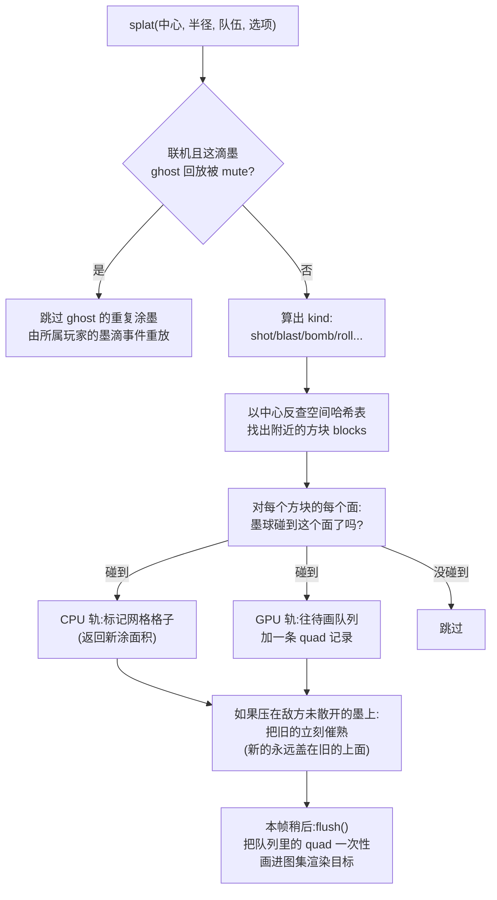

# INKWAVE 墨水系统图解(新手向)

> 目标读者:刚接触游戏开发/图形编程的人。尽量不预设背景知识,所有概念遇到就解释。
> 配套源码:[src/world/paint.js](../src/world/paint.js)、[src/world/inkShading.js](../src/world/inkShading.js)、[src/world/levelMaterial.js](../src/world/levelMaterial.js)。

---

## 0. 一句话版本

> 游戏里每一滴墨,从来不"存在"为一个物体。它只是往一张大贴图上画了一个会变形的圆,
> 再把这张贴图像壁纸一样贴回地板和墙面。玩法查询(这是谁的墨?)则由一张 CPU 端的粗网格回答。

---

## 1. 先搞清楚:我们要解决什么问题?

喷墨射击游戏的地面是一块**静态 3D 模型**(地板、墙、台阶)。玩家会往上面打几万发墨弹,
要求做到:

| 需求 | 难点 |
|---|---|
| ① 墨涂在地面上,能被覆盖 | 不能真的改地面模型的网格(太贵),也不能每滴墨建一个物体(几万个物体 GPU 撑不住) |
| ② 墨水要像液体 | 会扩散、有飞溅、墙上会往下滴、新的发亮、旧的发哑 |
| ③ 玩法判定 | "我站的地方是不是我的墨?""哪队涂地面积大?"要算得飞快 |
| ④ 联机一致 | 8 个玩家的屏幕上,同一块地必须看起来一模一样 |

INKWAVE 的答案是一个**双轨系统**:

```
        ┌──────────────────────────────────────────────────┐
        │           一次 splat() 调用(一滴墨落地)            │
        └──────────────┬───────────────────┬───────────────┘
                       │                   │
        ┌──────────────▼───────┐  ┌────────▼────────────────┐
        │   GPU 轨(负责"看")   │  │   CPU 轨(负责"玩")     │
        │                      │  │                         │
        │  往"图集"渲染目标上   │  │  往 0.25m 粗网格上      │
        │  画一个程序化的墨团    │  │  标记格子属于哪队        │
        │  → 得到逼真的墨水外观  │  │  → 回答:能游吗?谁的地?  │
        │                      │  │                         │
        │  消费方:玩家眼睛       │  │  消费方:游戏逻辑         │
        └──────────────────────┘  └─────────────────────────┘
```

**新手要点**:GPU 轨道的结果永不被游戏逻辑读取(读 GPU 显存很慢),CPU 轨道的结果永不被画出来(粗网格画出来是马赛克)。两条轨道各干各的,但用**同一套数学**保证它们不打架(第 5 节)。

---

## 2. 核心概念:什么是"图集"(Atlas)?

### 2.1 先把 3D 场景摊平成 2D 纸

下文用 2048×2048 图集举例;实际大小由画质决定:low/medium 为 2048,high/ultra 为 4096,见 [QUALITY](../src/config.js#L586-L592)。

想象你有一个纸盒子(3D 模型),想给它上色。一个聪明的办法是:把盒子**剪开、摊平**成一张平面图纸,在图纸上涂颜色,涂完再折回去。

```
   3D 场景(几个可涂墨的面)              摊平后的一张 2D 图集
 ┌──────────┐
 │  地板 A   │                        ┌──────────┬─────┐
 └──────────┘           ══▶          │  地板 A   │ 墙C  │
 ┌────┐                                ├─────┬────┴─────┤
 │ 墙B │  ┌────┐                      │ 墙B  │   地板 D  │
 └────┘  │墙C │                      └─────┴──────────┘
         └────┘                      ↑ 一张 2048×2048 的大贴图
```

代码里([_layout / _tryPack](../src/world/paint.js#L320-L348))这个过程叫 **shelf packing(货架打包)**:
把每个可涂墨的面按实际尺寸(米)× 分辨率(像素/米)换算成矩形,从高到低排序,一行一行摆进
2048×2048 的渲染目标里,放不下就降低分辨率再试(最多试 30 次)。

> **新手要点**:这就是"纹理空间绘制"(texture-space painting)。好处是墨滴在图集上只是个 2D 圆,
> 不管地面在 3D 里怎么拐弯,折回去之后墨水天然贴着表面——**墙角两侧的墨会自动连续**,就像真实液体绕过棱角。

### 2.2 每个面在图集里分到一个"货架格子"

```
图集(2048 × 2048 像素)
┌────────────────────────────────────────────────────┐
│ ┌─────────┐ ┌──────┐ ┌────┐                         │ ← 第 1 行(最高的先摆)
│ │  地板 A  │ │ 墙 C │ │墙E │  ...                    │
│ │(含 8px   │ │      │ │    │                         │
│ │  内边距) │ │      │ │    │                         │
│ └─────────┘ └──────┘ └────┘                         │
│ ┌──────┐ ┌──────────────┐                           │ ← 第 2 行
│ │ 墙 B │ │    地板 D     │                           │
│ └──────┘ └──────────────┘                           │
│                                                     │
│                 ⋮(用到的高度之外全空)                  │
└────────────────────────────────────────────────────┘
```

- 每个面记住自己的 `atlas = {x, y, w, h, ppm, pad}`——相当于"我在图纸上的哪一格";
- `pad`(约 8 像素)是留白的边,防止不同面之间串色(mipmap 缩小时颜色会渗透过边界);
- 这个渲染目标(`WebGLRenderTarget`)就是 GPU 内存里的一张**可以往上面画的贴图**。

---

## 3. 一滴墨落地时发生了什么:splat() 全流程



对应代码:[paint.js:512](../src/world/paint.js#L512) `splat()`。

### 3.1 "墨球碰到面了吗"是怎么算的?(纯高中几何)

墨滴是一个 3D 球(半径 R)。每个面是一个无限平面 + 一个矩形区域:

```
                 墨滴球心
                   ●
                ／  ＼        dn = 球心到平面的垂直距离
        面 ────────────────
             ↕ dn           rr = √(R² − dn²)  ← 墨在这个面上
              ↕ rr              留下的"圆形足迹"半径
        ═══════════════
             矩形面
```

- `dn > R` → 球在面外侧,够不着,跳过;
- `dn < −0.12` → 球钻进面背后去了,跳过;
- 否则足迹是个半径 `rr = √(R² − dn²)` 的圆。注意:**球心离面越远的邻面,墨印越小越淡**(`fall` 系数),这就是墨水"绕过墙角"时外侧自然变淡的效果。

### 3.2 一次 splat 会画好几个 quad

墨球可能同时蹭到地板、两面墙、一个台阶——每个被蹭到的面各生成 **一条 quad**(两个三角形),带上同一组参数(半径、队伍、种子、朝向)。所以 `MAX_QUADS = 6000` 是每帧待画墨滴实例的上限。

---

## 4. GPU 轨详解:在图集上"画"一滴墨

### 4.1 画贴图不用画家,用数学:SDF(有符号距离场)

quad 本身只是个占位符(覆盖墨滴可能触及的最大范围),真正的墨团形状是在 **fragment shader** 里用数学现场"长"出来的。核心是一个叫 **SDF** 的技巧:

> 对画面每个像素,算它"离墨团边界有多远"。距离为负 = 在墨里,为正 = 在墨外。
> 边界处距离为 0。于是"画形状"变成了"写一个距离函数"。

```
        距离场(示意)
        −2   −1    0    +1   +2
   ──────●────●────●────●────●──────
   深墨区 ←———→ 边界 ←———→ 区外
             sd = 0 的地方就是墨的边缘
```

用 `smoothstep` 把边界附近约 3 个像素宽的过渡变成平滑的覆盖率(存进 alpha 通道),
墨的边缘就不是锯齿,而是圆润的。

### 4.2 一个墨团 = 5 层形状叠加(从内到外)

fragment shader([paint.js:90-239](../src/world/paint.js#L90-L239))把一滴墨拆成 5 个部分,
每部分都是从哈希种子算出来的伪随机形状——所以**同样的种子永远长出同样的墨团**(这对联机回放至关重要,第 7 节):

```
        ④ 细密飞溅 spatter    ·  ·    · ·      ← 最晚落地(tn ≈ 1.4+)
         ·  ┌─────────┐  ·   ·
       ·   ╱  ③ 卫星液滴  ╲    ·            ← 落地稍晚,沿飞行线拉长
      ·   ╱  ●      ●  ●   ╲   ·
     ·   ╱ ② 射线射线射线射线 ╲  ·           ← 比主体先伸出去
    ·   │  ←→←→←→←→←→←→←→←→←→  │ ·          ← 带末端"墨珠"
    ·   │  ┌────────────────┐  │·
     ·  │ ╱   ① 主体(墨团)  ╲ │ ·           ← 从 40% 涨大到 100%
      · │ │   wob(θ, seed)   │ │·              ease-out 缓动
       ·╲ │                  │╱·
         ╲└────────────────┘╱
           ─────────────────
              ⑤ 墙面滴流 drips ↓↓↓         ← 仅墙面:下缘垂成流,
                                               顶端细、末端带"墨珠",蜿蜒下流 1.5~3s
```

| 部分 | 落地时机 | 视觉作用 |
|---|---|---|
| ① 主体 | 0 → 1(约 0.3s) | 轮廓是 `blobWobble(角度, 种子)`——5 个正弦项画出有机的波浪边 + 2 个尖锐余弦幂画出"甩出去的手指" |
| ② 射线 | 略早于主体 | 5~10 条短粗 taper 射线,多数钝、偶尔一条长,末端结珠 |
| ③ 卫星液滴 | 主体后一点 | 被冠部甩出的小滴,沿飞行方向拉成椭圆;在墙上会被重力拽偏下 |
| ④ 细密飞溅 | 最晚 | 更远处的小点 |
| ⑤ 滴流 | 持续 1.5~3s | 只有 `isWall` 才有:从墨团下缘垂下的流,头部膨大带着墨往下走 |

> **新手要点**:这些形状每帧都重新计算,但公式里唯一变量是"时间 tn"——所以同一条 quad 连续画很多帧,
> 墨团就呈现"扩散 → 液滴陆续落地 → 滴流下滑"的动画,**不需要任何状态记录**,幂等且便宜。
> 这也回答了"重画一遍不会叠深吗"——形状完全相同,叠上去等于没叠(混合方式见 4.4)。

### 4.3 不同武器 = 同一套系统的不同参数

```
  普通射击 shot        蓄力狙击 line          滚筒 roll
    ╭────╮              ╱──────▶              ▭▭▭▭▭▭
   (圆+拖尾)           (长条+拖尾)           (直边带状,轻微波浪)
   
  爆炸 blast            炸弹 bomb            墨点 trail/drop
   ╭──────╮            ╭────────╮              ·
  (射线更多更长)      (射线10/液滴12/飞溅14)   (小而简单)
```

kind 只影响 4 个数字:`kindShape()` 返回 `(射线数, 液滴数, 飞溅数, 滴流数)`([paint.js:111-119](../src/world/paint.js#L111-L119))。滚筒特殊:主体是**直边矩形带**(滚筒压过去的痕迹),代码里用 `BAND_L/BAND_W` 定义。

### 4.4 图集像素的 RGBA 编码 & 混合公式

每个像素存 4 个通道([paint.js:238](../src/world/paint.js#L238)):

```
   R              G               B               A
 ┌──────┐      ┌──────┐       ┌──────┐       ┌──────┐
 │队伍份额│      │ 湿度 │       │ 色调 │       │覆盖率 │
 │0=橙队 │      │新墨=1│       │每滴墨 │      │0~1   │
 │1=蓝队 │      │干燥→0│      │一个随机│      │平滑  │
 │新盖旧 │      │≈6秒 │       │明暗值 │      │3像素 │
 └──────┘      └──────┘       └──────┘       └──────┘
```

混合(blending)是这个系统的精妙处,RGB 和 A 用**不同规则**([paint.js:415-426](../src/world/paint.js#L415-L426)):

```
RGB:"over" 合成 →  结果 = 新墨颜色 × 新覆盖率 + 旧颜色 × (1 − 新覆盖率)
                  (谁后画谁赢:同一像素上蓝墨盖橙墨,边界处渐变过渡)

 A :"max"  合成 →  结果 = max(新覆盖率, 旧覆盖率)
                  (墨滴并集:重画同一滴扩散中的墨,覆盖率取大,不会叠深)
```

> **新手要点**:"max" 让扩散动画幂等(每帧重画同形状不会越来越黑);"over" 让两队墨水在边界处
> 是漂亮的覆盖渐变而不是硬切换。两个规则各管一件事。

### 4.5 干燥:一个"减法"pass

新墨 G=1(发亮),每帧有个全图集的小 quad 用**反向减法混合**把 G 减掉一点(约 6 秒归零),
和墨滴画在同一个 pass 里——这样 mipmap 链每帧只重建一次([paint.js:432-446](../src/world/paint.js#L432-L446))。

```
  刚涂上         3 秒后          6 秒后
  G=1.0          G≈0.5          G=0
  ╭────╮         ╭────╮         ╭────╮
  │发亮│   →     │半哑│   →     │全哑│
  │高光锐│       │           │  边缘出现褶皱 │
  ╰────╯         ╰────╯         ╰────╯
```

---

## 5. CPU 轨详解:0.25 米网格 + "同一条边界"

### 5.1 网格长什么样

每个可涂墨的面在 CPU 内存里对应一个二维格子数组,格子边长 0.25 米:

```
  一个 3m × 3m 的地板面 → 12 × 12 = 144 个格子
  ┌───┬───┬───┬───┬───┬───┬───╥───┬───┬───┐
  │ 0 │ 0 │ 0 │ 1 │ 1 │ 1 │ 1 ║ 1 │ 0 │ 0 │   0 = 无墨
  ├───┼───┼───┼───┼───┼───┼───╫───┼───┼───┤   1 = 橙队
  │ 0 │ 1 │ 1 │ 1 │ 1 │ 2 │ 2 ║ 2 │ 2 │ 0 │   2 = 蓝队
  ├───┼───┼───┼───┼───┼───┼───╫───┼───┼───┤
  │ 0 │ 0 │ 2 │ 2 │ 2 │ 2 │ 2 ║ 0 │ 0 │ 0 │   ║ = 两队边界
  └───┴───┴───┴───┴───┴───┴───╨───┴───┴───┘
        ↑ 栅格化:墨团只问每个格子中心
          "你在 blobWobble 边界内吗?"
```

初始化时([paint.js:350-377](../src/world/paint.js#L350-L377))还做了一件事:把每个格子中心
往面内推 6cm,问关卡几何"这个点是不是埋进别的几何体里了"——是的话标记为 `dead`,
**被埋住的格子永不计分**(防止柱子、台阶内部算成可涂面积)。

### 5.2 关键:CPU 和 GPU 用同一条边界函数

这是整个系统"看起来和玩起来一致"的根基:

```
   CPU 端 (JS)                      GPU 端 (GLSL)
   blobWobble(ang, seed)     ≡      wob(a, s)          ← 逐行对照的同一公式
   (paint.js:43-47)                 (paint.js:74-78)
```

但 CPU 只算到**主体边缘**(wob 的最大包络 WOB_MAX = 1.5),不算射线、液滴、飞溅、滴流:

```
   GPU 画出来的(判分只看实心框内):        CPU 记录下来的:
   · ·  ·····                            ┌──────────┐
    · ╭─────────╮··                       │ ■■■■■■■■ │
     ╱ ■■■■■■■■■ ╲    ·                    │ ■■■■■■■■ │
    │ ■■■■■■■■■■■ │        ═▶              │ ■■■■■■■■ │
    │ ■■■■■■■■■■■ │                        └──────────┘
     ╲ ■■■■■■■■■ ╱       装饰部分(射线/液滴/    只有主体,
      ╰─────────╯       飞溅/滴流)比 0.25m    边缘按 wob 精确计算
        · · · ·        格网更细,不碰判分     新覆盖的格子数 × 格面积
```

> **新手要点**:如果 GPU 画了 2.5m 大的一滴墨而 CPU 按 2.5m 实心圆记,那么"看着涂到了却没分"
> 的挫败感就出现了。这里反过来:边缘用同一公式的**最大可达范围**做包围,格中心在包围内才算被涂,
> 精确边界由 wob 给出——视觉和判定共享一条边。

### 5.3 这个网格回答了玩法的一切问题

```js
paint.sample(worldPos)      // 脚下是干的/我的墨/敌墨?(鱿鱼形态判定)
paint.coverage()            // 两队涂地百分比(裁判用)
paint.regionStats(...)      // 区域控制模式:某区域两队份额
counts[team]                // 大招充能:涂地面积积分
```

查询就是一次数组下标:面 id → 格子 (i, j) → `grid[base + j*nu + i]`,**O(1)**。

---

## 6. 渲染端:把图集"贴回去",并让它像真的墨

图集只是一张数据贴图,真正让它变成"墨水"的是关卡材质里的着色代码
([inkShading.js](../src/world/inkShading.js),被 [levelMaterial.js](../src/world/levelMaterial.js)
用 `${INK_*}` 占位符拼进 MeshPhysicalMaterial)。

### 6.1 近处:B 样条重建,远处:mipmap

```
  贴图直接双线性采样          三次 B 样条重建(近处)
  ╭──╮                      ╭──╮
  │▞▚│  方块感、边界棱角        │  │  圆润轮廓 + 连续的"高度场"
  ╰──╯                      ╰──╯  (C2 连续,梯度可解析求导)

  远处:普通 mipmap(反正看不清)+ 梯度钳制在 ≤8 纹素
       (防止采到跨面的粗 mip 层而串色)
```

B 样条的价值不只是圆润:它给出**解析梯度**(每个通道对 x/y 的导数),后面所有
"立体感"都建立在这个梯度上。

### 6.2 让墨有体积感:弯月唇、重叠唇、涟漪

光有颜色像贴纸,这三件套让它像凝胶状的液体:

```
  ① 弯月唇(meniscus lip)         ② 两队重叠唇               ③ 涟漪
  墨的边缘微微隆起一圈               湿墨叠在旧墨上,交界处      落点向外扩散的
  湿润时更高更亮                  湿的一边的唇"骑"过去         环形波纹
        ╭──╮                          橙▒▒▒╮                       .-""-.
      ╱ 隆起 ╲                        蓝▓▓▓▓│ ← 更高的唇           (  环  )
      │ 区域 │    干燥后变矮变哑        └────┘                        `-..-'
      ╰────╯
  实现:对覆盖率场 A 做梯度运算,       实现:R 通道(队伍份额)的        实现:24 个
  沿法线方向顶起表面                   梯度方向上叠加隆起              全局波纹槽位,
                                    (湿的一边高)                   脚步/跳跃/墨滴
                                                                    都会注入一个
```

### 6.3 光照:湿墨的高级感来自哪里

- **透明 coat(clearcoat)**:新墨 =  sharp 的湿光泽(像清漆),旧墨 = 缎面;
- **被驯化的掠射菲涅尔**:低角度看地面时,普通 PBR 会让颜色被反射盖掉变成"一坨棕",
  这里压低菲涅尔,**低角度看也保持队伍色**;
- **唇部半透明**:边缘一圈颜色更浅更透,像液体表面张力;
- **投影**:墨唇会在地板上投出背离太阳方向的接触阴影,让墨"浮"在地面上;
- **墙面晕染**:墙上墨水外缘有一圈"洇进材质"的潮气晕。

---

## 7. 联机:一滴墨如何出现在 8 个人的屏幕上

联机时每个玩家只模拟自己的角色。墨水同步走的不是"同步结果"而是**同步成因**:

```
  玩家A 开枪 paint.splat(中心, 半径, 队伍, {seed: 0.731...})
     │
     │  网络层记录这条调用(netmatch.js recSplat)
     ▼
  中继转发 ────────────────────────────▶ 玩家B/C/D... 的 paint.splat
                                            (同样的参数,同样的 seed)
                                               │
                                               ▼
                            同样的公式 + 同样的种子 = 同样形状的墨团
                            (第 4.2 节:形状完全由 seed 决定,无随机状态)
```

> **新手要点**:这就是"确定性回放"。因为墨团形状是**种子 → 形状**的纯函数,
> 只要传 4 个数字(位置、半径、队伍、种子),所有端就能独立算出**逐像素一致**的墨。
> 他人屏幕上你射出的飞行墨滴只是不涂墨的"视觉幽灵",真正的涂墨指令来自你的端。

---

## 8. 全景收尾:一图流

```
                  玩家开枪
                     │
        ┌────────────┼────────────────────────────┐
        ▼            ▼                            ▼
   命中几何      CPU 轨(每滴墨)              网络(联机时)
   查询面列表     · 0.25m 网格标记             记录 splat 参数
        │        · 返回新涂面积(分数/充能)      广播给其他玩家
        ▼        · 催熟被压的敌方墨
   每面生成 quad  ▼
        │     GPU 轨(每帧 flush 一次)
        ▼        · 6000 实例的大 BufferGeometry
   fragment        · SDF 画出 5 层形状
   shader 里      · RGB over / A max 混合进
   "长"出墨团 ──▶   图集渲染目标(2048²)
        │        · 减法 pass 干燥湿度 G
        ▼            │
   图集 = 数据贴图    │
   (R队 G湿 B调 A盖)  │
        │            ▼
        ▼        关卡材质(每像素)
   玩家眼睛 ◀──── B 样条重建 → 弯月唇/重叠唇/涟漪
   看到湿亮的墨水    → 队伍色×色调 → clearcoat → 屏幕
```

---

## 9. 关键数字速查

| 数字 | 位置 | 含义 |
|---|---|---|
| `2048 × 2048` | paint.js `_initGPU` | 图集渲染目标尺寸 |
| `0.25 m` | paint.js `_initGrid` | CPU 判定网格边长 |
| `6000` | `MAX_QUADS` | 每帧墨滴实例上限 |
| `1.5` | `WOB_MAX` | blobWobble 最大半径倍率(CPU 格扫描边界) |
| `≈ 6 s` | 干燥 pass | 新墨 → 全干的时间 |
| `8 px` | `pad` | 图集内面与面之间的防串色边距 |
| `24` | `INK_RIPPLES` | 同屏涟漪槽位数 |
| `±3 纹素` | coverage profile | 墨边界的平滑过渡宽度 |

## 10. 新手常见疑问

**Q:为什么不让 GPU 算涂地面积?**
GPU 的结果在显存里,读回来要同步等待,几百微秒的卡顿每帧都来一次游戏就没法玩了。0.25m 网格几十万格子,一次遍历不到 1ms。

**Q:墨滴扩散动画会不会越涂越深?**
不会。形状是时间的纯函数,每帧重画同一个形状;"A 取 max" 的混合让重叠部分覆盖率不变。

**Q:为什么射线/液滴不记入判分?**
故意的。它们比 0.25m 格子更细,记进去会出现"看着没涂到却有分"。判定只认主体边缘,且主体边缘公式与 GPU 逐行一致。

**Q:两队墨在图集里打架怎么办?**
R 通道"后画者赢"(over 混合),边界处是渐变。CPU 侧格子只存 0/1/2 整队,后涂的覆盖先涂的——两边规则天然一致。

**Q:换分辨率/画质档会影响墨吗?**
图集 ppm 按最大密度打包失败后自动降档重试,墨的所有数据(网格、种子)与渲染分辨率无关。
