# INKWAVE 多人游玩机制与 Go 服务器改造入门

更新：2026-10-28。当前实现依据本仓库 `2141f98`；下文把“现在已经实现的机制”和“未来改造建议”分开说明。本文只增加文档，不启动游戏测试、不改联机代码，也不继续性能优化。

**先记住三件事：现在每个人的设备计算自己的角色，房主额外计算 Bot 和比赛规则，云端主要转发消息。未来 Go 可以先接替转发，再逐步接替裁判和游戏模拟；Docker 则负责把服务器程序打包运行。**

建议第一次先读第1～9节，理解现状；第二次读第10～15节，讨论改造。第16节汇总免费额度、房主掉线、伤害归属和打击延迟的常见问题。图中的小明是房主，小红是加入房间的玩家。文中的“模拟”指计算位置、碰撞、伤害等玩法状态，“渲染”指把状态画成画面。

## 1 三个人一起玩时 到底是谁在运行游戏

你和朋友各自打开游戏，各自都有一份地图、人物模型、墨迹和正在运行的程序。网络传递位置和事件，让这些副本尽量保持一致，并不是房主把游戏视频直播给别人。

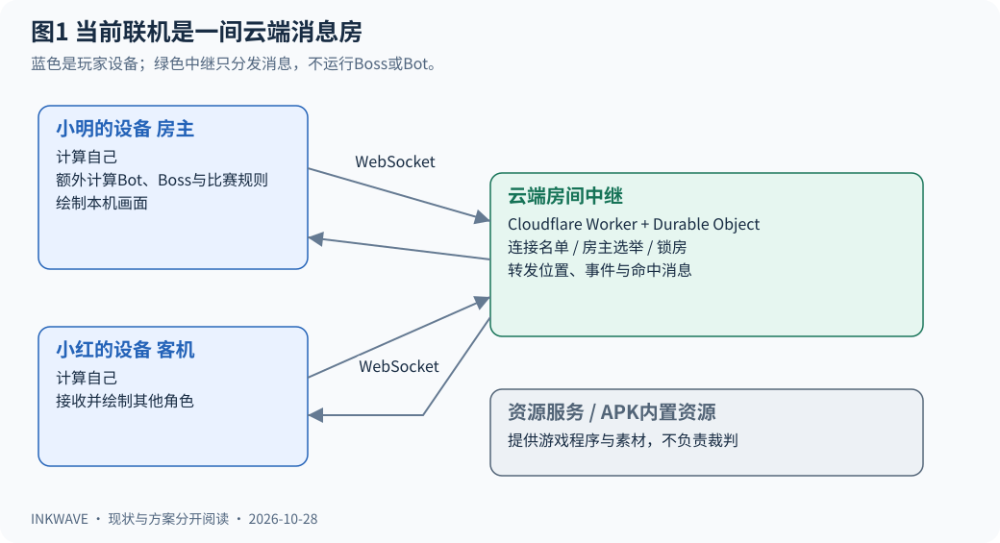

这里有两种容易混淆的“服务器”：

| 名称 | 通俗理解 | 目前负责什么 |
| --- | --- | --- |
| 静态资源服务 | 发游戏安装材料的仓库 | 浏览器下载 HTML、JS、模型等；APK主要从包内读取资源 |
| 房间中继 relay | 房间里的消息分发员 | 维护连接名单、选房主、锁房和转发消息 |
| 房主的客户端 | 玩家的设备兼任部分裁判 | Bot、比赛时钟、Boss、区域控制和最终结算 |

**目前网络连接是星型 WebSocket，不是玩家之间直接建立 WebRTC 连接。**每人一条 WebSocket 连云端房间；从小明发到小红的游戏消息也经过云端。Cloudflare Worker负责入口，房号对应一个 Durable Object，可以把它理解为“这个房间自己的连接管理员”。[实现：transport.js](../src/net/transport.js)、[中继源码](../server/src/index.js)。

Docker可以托管Go中继或未来游戏服，但不会替玩家绘制画面，也不会自动变成云游戏。

## 2 谁说了算 先分清所有权

“权威”就是一件事发生争议时，采用谁给出的结果。“所有者 owner”则表示由哪个客户端真正推进某个角色。

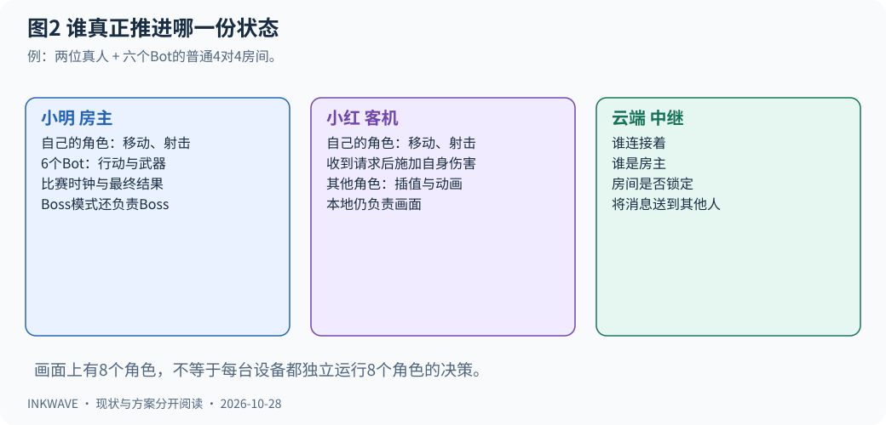

例如只有小明、小红两个人，普通4对4开启Bot补位：小明模拟自己和6个Bot，小红只模拟自己。小红屏幕上仍能看到8个角色，但其中7个主要通过网络状态和动画回放呈现。

| 对象或结果 | 当前谁决定 | 其他设备怎么做 |
| --- | --- | --- |
| 小明的位置和动作 | 小明自己的客户端 | 接收小明的状态并平滑播放 |
| 小红的位置和动作 | 小红自己的客户端 | 接收小红的状态并平滑播放 |
| Bot的行动 | 房主 | 回放Bot的状态 |
| 玩家对玩家的命中 | 射击者提出命中，目标所有者实际扣血 | 播放命中、击倒、重生等反馈 |
| Boss行动和Boss血量 | 房主；客机把命中请求发给房主 | 根据房主快照和招式事件播放 |
| 最终胜负和统计 | 房主 | 接受房主结果 |
| 哪些连接仍在房间、谁是房主 | 中继 | 按中继通知更新 |

这是一种**分散在客户端上的权威模型**。虽然房主有重要职责，所有真人角色也不是统一交给房主计算。手机自己建一个人加Bot的房间，仍会承担房主工作；仅把中继改为Go不能把这些计算卸载出去。[实现：NetMatch](../src/net/netmatch.js)、[Match](../src/game/match.js)。

## 3 从输入房间码到开始战斗

客户端通常生成5位房间码。中继路由允许4～8位字母数字，故“UI生成5位”和“服务端接受4～8位”并不冲突。邀请码是找到房间的地址，不是登录账号，也不是安全密码。

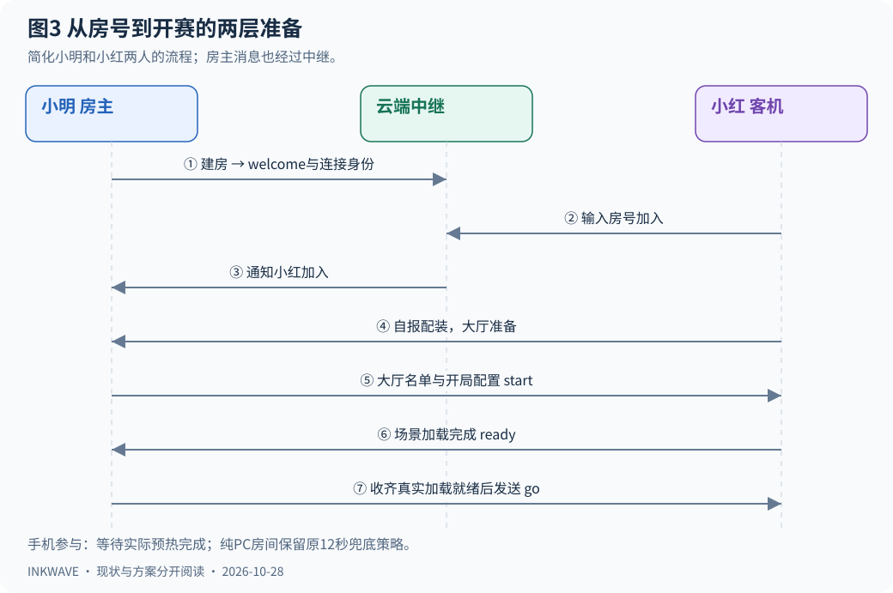

过程可以理解为一次集合出发：

1. 小明建房，中继回复他的连接ID和房主ID。
2. 小红输房号加入，中继告知双方“多了一位成员”。
3. 小红把名字、武器、外观等交给房主；房主整理完整大厅名单并广播。
4. 小红按大厅“准备”。房主通常通过 `canStart()` 判断大家是否准备好。
5. 房主下发统一地图、模式、时间、配色和 `roster`，同时锁房，拒绝中途新加入。
6. 每个设备加载场景，完成后再发一次加载 `ready`；房主收齐后发 `go`。
7. 各端收到发令进入战斗。收到消息存在网络时差，不是物理上同一毫秒起跑；时钟后续还会校准。

**大厅的“我准备参加了”和加载完成的“我的设备准备好了”是两层条件。**当前手机参与的房间等待真实加载/预热完成；纯PC房间保留12秒兜底发令策略。不要改Go时漏掉这个差别。另一个代码细节是 `start()` 本身不重新逐人检查大厅准备，UI的 `canStart()` 承担正常入口检查；未来服务器接管时应独立校验。[实现：session.js 的 start、_begin、_checkReady](../src/net/session.js)。

普通涂地、区域控制最多4对4；Boss模式会把真人放进同一支队伍，开启Bot时补至最多8人，不能把Boss理解成两个玩家阵营互打。特殊 `noBots` 地图还会限制开赛人数并禁用Bot。

## 4 你走一步 为什么别人看起来是连续移动

小明按前进时，本机立即计算移动并绘制，不用等待中继批准。这解释了为什么本地操作响应快，但并不代表整条网络没有延迟。

当前每个所有者目标每秒发送20次快照，即20Hz，通常间隔约50毫秒。画面则可能每秒绘制30或60次，**网络20Hz不等于画面只能20FPS**。卡顿时不会连发全部遗漏快照来补账。

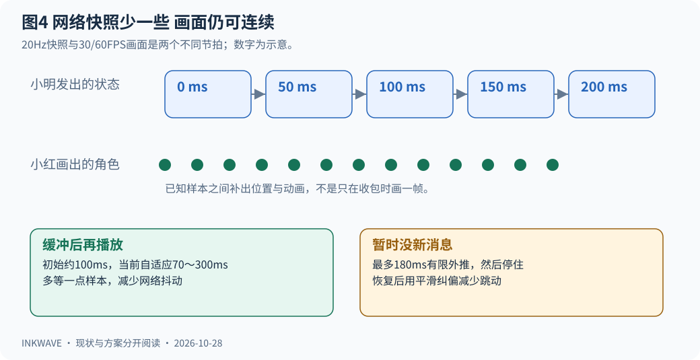

小红收到小明的两个位置，例如“这里”和“前面一米”，会在中间生成平滑路径。代码用Hermite插值：不仅参考位置，也参考速度，因此转弯不只是把几个点用生硬直线串起来。

为了给第二个点留到达时间，小红故意播放稍早一点的小明。初始缓冲约100毫秒，目前代码按最近样本的发送间隔和迟到量调整到70～300毫秒。网络临时没包时最多做180毫秒的有限外推，再停住；重生靠传送计数器切换，避免从死亡点滑行到出生点。这些机制减轻抖动，不能保证任何网络和设备卡顿下都看不到跳动。

> 原NET文档仍写85～300毫秒和旧的缓冲公式；本说明以当前 `netmatch.js` 的 `_tick` 为准。回放缓冲也不是完整端到端延迟，实际还包含传输和显示等时间。

## 5 一枪打中朋友 经过哪些设备

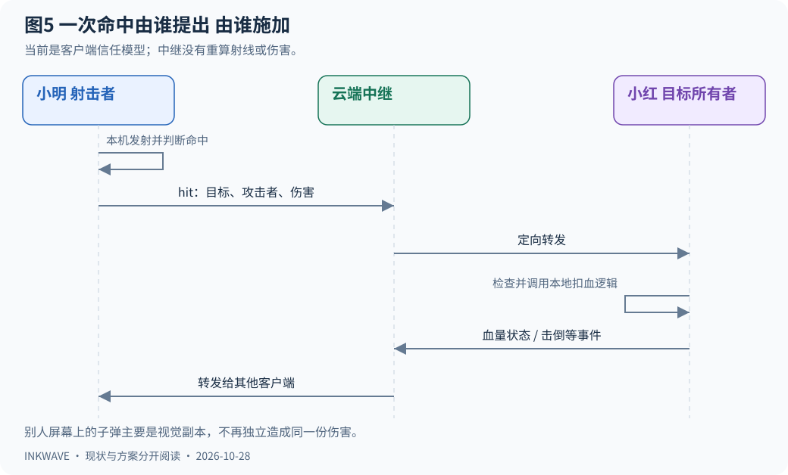

小明的客户端计算自己的子弹，并在自己的视角判断是否击中小红。如果击中远端角色，就定向发送类似这样的请求：

```json
{"k":"hit","v":2,"a":1,"d":30,"w":"shooter"}
```

这里 `a` 是攻击者角色编号，`v` 是受害者角色编号，`d` 是请求伤害；编号仅为例子。小红的客户端检查目标是否由自己拥有、是否存活、是否为敌人，再调用本地伤害逻辑。中继负责送到，不验证子弹有没有被墙挡住。

你在小红屏幕看到的小明子弹，主要是“视觉副本 ghost”。它提供弹道、声音和特效，但不会再独立计算一次相同伤害和涂墨，否则一发子弹可能重复生效。ghost在这里指视觉副本，不是作弊。

这是适合朋友私房的信任模式。当前 `hit` 处理没有完整地用连接来源校验攻击者身份，也没有服务器重算射线与射速；Boss命中处理也主要信任客端报告，存在部分数值约束。**部署成公网竞技服务时，这些信任边界需要重新设计。**这不表示当前每个客户端能随意修改别人的位置：角色快照已有owner与发送者一致性检查，只是不同消息的校验程度不同。

## 6 墨水怎么同步 为什么不把地面截图发过去

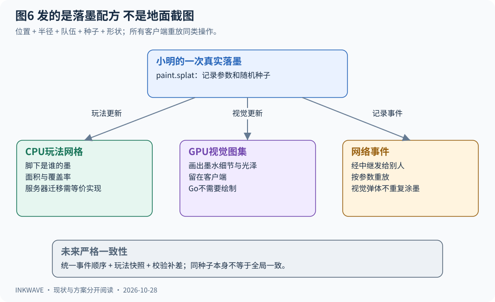

小明的墨弹落地，游戏记录这次涂墨的中心、半径、队伍、形状参数和随机种子，作为事件发给别人。随机种子相当于“这团随机墨点的配方编号”：接收者用同一配方重做，而不是自己再随便随机一次。

每次落墨又同时影响两种数据：

| 数据 | 用途 | 未来权威服需要吗 |
| --- | --- | --- |
| CPU涂地网格 | 脚下是谁的墨、面积、玩法查询 | 需要与当前规则等价的实现 |
| GPU墨水图集 | 光泽、细节、颜色等画面 | 保留在客户端，Go无需绘制 |

因此网络主要传“在哪里涂了一团墨”，不是不断上传整张2048或4096像素贴图。当前 `Paint` 的玩法网格每格约0.25米，视觉细节另外处理。[实现：world/paint.js](../src/world/paint.js)、[墨水通俗说明](INK.zh-CN.md)。

“同种子重放”旨在复制相同墨块，但**不能单凭这一点承诺所有客户端的整张地图永远逐字节一致**：当前不同发送者有独立时间轴，重叠墨迹的跨发送者顺序、参数量化、丢线都会影响一致性。最终结果采用房主统计。未来需要严格统一时，服务器应为落墨安排全局事件序号，并提供校验和、快照与补差；快照还需覆盖玩法所需的年龄/湿度等状态及视觉恢复方式，不能只保存最终队伍颜色。

## 7 多人一起打Boss 和普通对战有什么不同

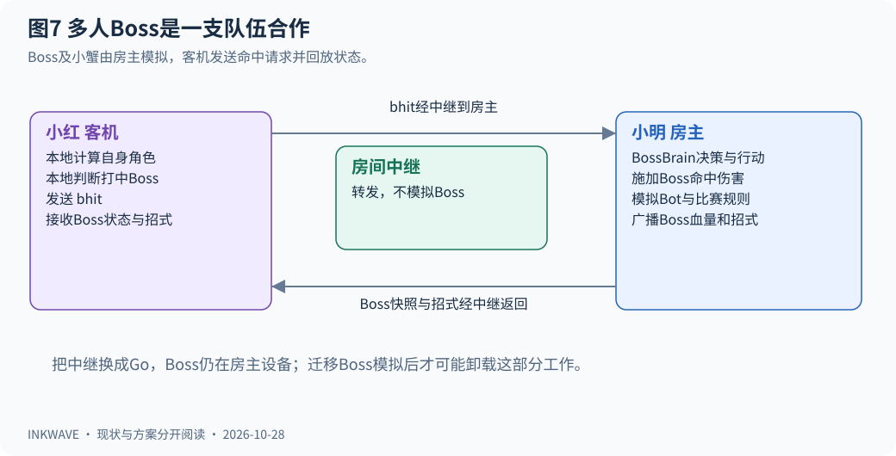

房主的BossBrain选择招式、推进Boss和小蟹状态；客机主要接收Boss快照、招式和爆发等事件。房主每个20Hz tick带Boss状态，每10次发送一次完整包，约每0.5秒一次；客机在房主的回放时间轴上呈现它。

小红打中Boss，发 `bhit` 给房主，房主修改Boss血量并同步；大家不会各自运行一只独立决策的Boss。最后Boss是否被击败、胜负与统计以房主结果为准。[实现：boss.js 的 remoteHit、pack、adopt](../src/boss/boss.js)。

这解释了一个实际现象：房主设备负担可能比客机重。未来只让Go做转发，Boss依旧在房主设备；只有把Boss与依赖的碰撞、伤害、涂地规则搬到服务器，才有机会卸载这部分工作。具体手机收益仍需改造后测量。

## 8 房主退出 游戏为什么还能继续

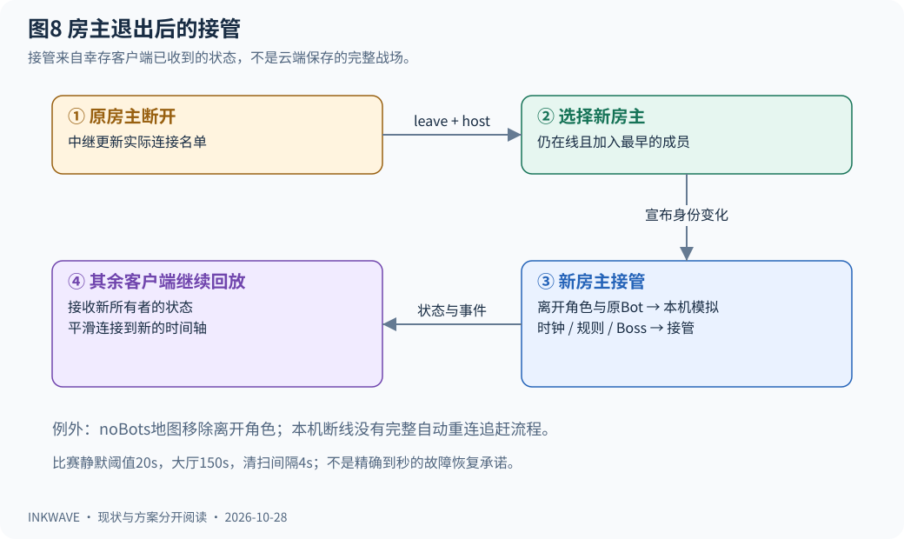

中继按加入顺序选择仍在线的最早成员为新房主。它只宣布“现在换谁当房主”，没有把一份完整服务器战场存档发过去。新房主从自己已经接收到、显示着的角色和Boss状态接管。

普通允许Bot的地图里，离开玩家的原角色由新/现房主接成Bot；原房主拥有的Bot也一起转移。新房主获得时钟和裁判职责，Boss通过 `adopt()` 接管。`noBots` 地图的离开角色会被移除，而不是强行补Bot。

所以“有主机迁移”不等于“能精确无损恢复任意服务器存档”。瞬间尚未送达的消息、视觉副本或内部决策状态仍需分别考虑。所有人都走了，房间也不是永久保存的世界。

当前客户端每2秒发文本 `ping`，超过20秒未收到回应会关闭假活连接；中继每4秒清扫，比赛静默阈值20秒，大厅150秒。阈值不是精确踢人时刻。原NET文档写比赛10秒，已与源码不一致。**本机连接掉线会中止本局；当前没有凭旧身份自动重连并追赶完整战场的恢复流程。**由于比赛锁房，也不能简单刷新后当新玩家加入进行中的比赛。

## 9 原文里的缩写 用一张表看懂

| 词或消息 | 新手解释 | 出现位置 |
| --- | --- | --- |
| `G.net` | 联机会话总管，管房间与开赛 | src/net/session.js |
| `G.netm` / NetMatch | 当前一局的网络同步员 | src/net/netmatch.js |
| `Transport` | 负责连接、发送、收取的通信外壳 | src/net/transport.js |
| `roster` | 开局固定角色名单，含队伍、武器、所有者 | session.js 的 start |
| `myId` / `owner` | 当前连接身份 / 某角色的计算归属 | session、netmatch |
| `nid` | 本局角色编号，与连接ID不同 | roster、packActor |
| tick / snapshot | 按节拍发送的状态快照，不是屏幕截图 | `k:'t'` |
| event | 一次发生的事情，如射击、落墨、招式 | tick的 `e` 数组 |
| interpolation / extrapolation | 两个已知点之间补画 / 没新点时短暂推测 | applyRemote |
| `b\|JSON` | 发给房间其他所有人的信封 | 中继原样转发负载 |
| `s\|目标ID\|JSON` | 只发给一个人的信封 | 例如定向命中 |
| `m\|来源ID\|JSON` | 中继送给接收者的信封，来源由连接确定 | Transport解析 |
| `t:'welcome/join/leave/err'` | 中继控制消息 | 身份、成员变动、失败 |
| `k:'lobby/start/ready/go'` | 游戏层大厅和开赛消息 | 房主与客机编排 |
| `k:'hit/dh/bhit'` | 玩家 / 装置 / Boss命中 | 接收端施加 |
| `k:'st/res/end'` | 比赛状态 / 最终结果 / 返回大厅 | 只接受房主来源 |

WebSocket基于可靠有序的TCP；同一条连接会保序，但不能据此推导所有玩家有一个共同的全局事件顺序。消息堵住时后续消息也会等待，且连接断掉并不自动补回应用事件。当前客户端发送积压超过256KiB会关闭连接，避免无限排队。中继还有消息长度与速率预算；这类保护不是完整反作弊。[错误码说明](../src/net/errors.js)。

## 10 引入Go 先选你想解决的问题

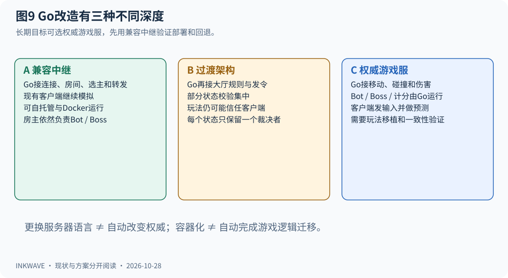

| 路线 | Go接管的工作 | 保留的客户端工作 | 能解决什么 | 还解决不了什么 |
| --- | --- | --- | --- | --- |
| A 兼容中继 | 房间连接、房主选举、转发、限流 | 现有房主/玩家模拟 | 自托管、部署可控、摆脱对Cloudflare房间运行时的依赖 | 房主负担、客户端作弊、完整断线恢复 |
| B 过渡架构 | 再接管大厅规则、发令、状态版本、结果接收 | 移动/射击仍由客户端，Bot/Boss仍可能在房主 | 房间管理和验证更集中 | 如果仍采信客户端胜负，就不是完整权威服；重连仍需快照设计 |
| C 权威游戏服 | 移动、碰撞、Bot、Boss、伤害、落墨顺序、胜负 | 输入采集、预测、插值、渲染和音画 | 独立裁判，减少对某个玩家设备的依赖 | 需要移植玩法逻辑和做大量一致性验证 |

**建议以C为长期目标，先交付A作为可回退的第一阶段。**这样先学会并验证Go与Docker部署，再把模拟逐项迁移。B只在有明确里程碑时采用，不要长期让房主和Go同时裁决同一份血量或时钟。

Go中继可以在第一阶段保留现有房号、`/room/<CODE>`、协议版本1、文本信封与错误码，通过现有 `?relay=` 指向测试地址。开始迁移游戏权威时使用明确的新协议版本或独立路径，避免旧客户端误把服务器状态当另一个玩家广播。Go并不是把原JS文件扩展名改掉；Cloudflare的Room对象生命周期、自动心跳和连接附件都需要重新实现。

## 11 真正的独立游戏服 怎么保持操作手感

目标架构中，玩家发“我按了前进和开火”，由Go计算“你实际走到了哪里、有没有击中”。客户端仍立即预测自己移动；收到服务器结果后纠正并重放尚未确认的输入，其他玩家则按快照插值。

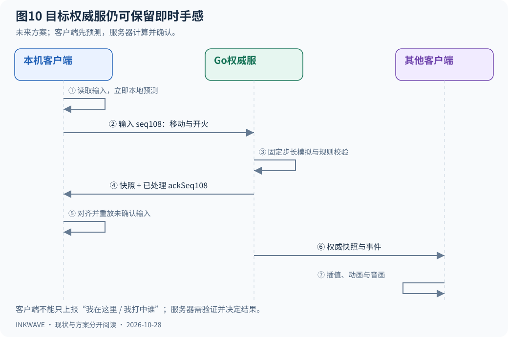

示意协议如下，**是设计草案，不是现有可用接口**：

```json
{"type":"input","matchId":"M1","seq":108,"move":[0,1],"yaw":1.2,"buttons":5}
{"type":"snapshot","matchId":"M1","serverTick":680,"ackSeq":108,"actors":[]}
{"type":"event","matchId":"M1","eventSeq":9002,"serverTick":680,"kind":"ink","data":{}}
```

服务器根据连接/会话识别玩家，不能信任输入中自称的攻击者ID。`seq`是输入序号，`ackSeq`告诉你已处理到哪条；`serverTick`是服务器模拟时刻，`eventSeq`帮助防重复并确认事件顺序。共享广播快照若包含确认信息，需要按玩家带确认表，或为接收者单独附上确认序号。网络包到达时间不能直接决定走多少米，移动按服务器固定步长推进。

可先把“模拟30Hz、广播20Hz、客户端30/60FPS渲染”作为待测起点，三个节拍独立；**30Hz不是本项目已经验证的最终参数**，高速弹体和碰撞仍需子步或连续检测，不能为了服务器省算力直接改变原武器与物理规则。

当前采用射击者视角命中，换成服务器当前时刻命中可能改变手感。若需要延迟补偿，服务器保存有限时间的历史命中体，按校验过的输入时刻回溯；限制回溯窗口和时间戳，不能让客户端随意宣称“我刚才打中了”。具体窗口要通过延迟/公平性测试确定。

## 12 哪些代码应该搬 哪些应留在客户端

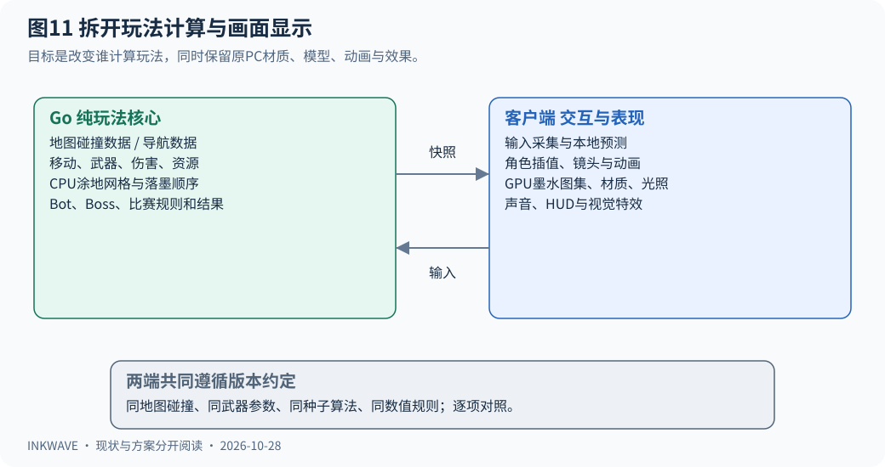

| 模块 | Go目标实现 | 客户端保留 | 首要验证 |
| --- | --- | --- | --- |
| 角色 | 移动、碰撞、HP、资源、武器冷却 | 本地预测、模型、镜头、动画 | 同输入下跳跃、爬墙、台阶、鱿鱼形态一致 |
| 武器/副武器/大招 | 弹体、射线、装置生命、伤害、落墨 | 枪口焰、声音、视觉弹体、预测反馈 | 每种武器同距离/时间的命中和消耗一致 |
| Bot/Boss | 决策、导航、危险区、阶段和伤害 | 按权威状态播放动画与特效 | 招式时序、阶段、目标选择与伤害正确 |
| 涂地 | 面数据、网格、种子算法、面积与覆盖顺序 | 纹理图集、光照、湿墨视觉 | 同序事件下CPU网格/计分一致，视觉保持 |
| 比赛规则 | 时钟、区域控制、结算 | HUD和结算动画 | 胜负/加时/倒计时一致 |

现有物理查询针对地图有向盒，JS里使用THREE向量；地图/角色/涂墨也和全局 `G`、画面对象互相引用。需要先导出版本化地图玩法数据，例如碰撞盒、可涂面、出生点、导航与规则参数，并把纯玩法计算拆出来。Go使用这些数据，不需要加载three.js模型来渲染。

Go不应仅用“全地图一张俯视格子”替换现有按面的涂地查询，否则墙面、上下层与覆盖率可能改变。种子算法、数值量化和浮点边界也要建立JS/Go固定样例对照。显示层继续用现有材质、精度、模型和效果；服务器迁移不以改变PC画面或玩法作为捷径。

推荐从一个小场景、一种基础武器开始双端对照，再扩到全部内容。可让原JS逻辑作为对照工具，但每个正式房间只能有一个最终裁决者。不要把全部玩法一次性重写后才首次联调。

## 13 Go内部如何组织 才不会互相抢状态

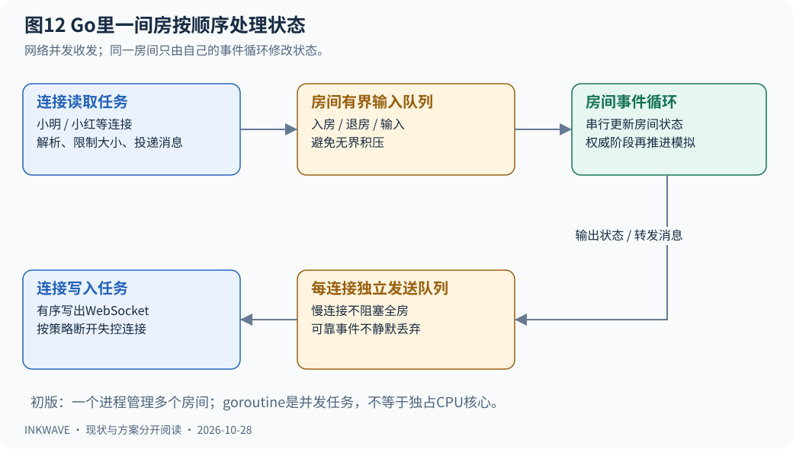

推荐初版一个Go进程管理多个房间，每个房间用一个goroutine事件循环串行修改状态。goroutine可以理解为Go安排执行的一项并发任务，不等于一间房独占一个CPU核心。网络读取把消息交给房间，房间负责按序处理；网络发送使用各连接自己的有界队列，慢客户端不能拖住整个房间。

建议目录草案：

```text
server-go/
  cmd/inkwave-server/        程序入口与配置
  internal/transport/       WebSocket连接、心跳、读写队列
  internal/room/            房号、成员、开赛、生命周期
  internal/protocol/        消息结构、版本、校验
  internal/sim/             后续权威玩法模拟
  internal/maps/            导出地图玩法数据的加载
  internal/observability/   健康检查、指标、结构化日志
```

第一阶段A不必运行游戏模拟tick；房间事件循环只处理成员和转发。阶段C再加入固定步长模拟。初版一进程即可，无需先引入微服务、Redis和Kubernetes。

扩容时有一个关键条件：**同一个房号必须落到同一台负责它的进程**。负载均衡“同一条WebSocket固定在某台机器”还不够，小明和小红是两条不同连接，不能被分到两个互不相识的同名房间。后续可加房间目录/分配服务；Redis适合辅助定位房间，不会自动替你同步整个高频战场。

## 14 Docker部署 图里每层分别干什么

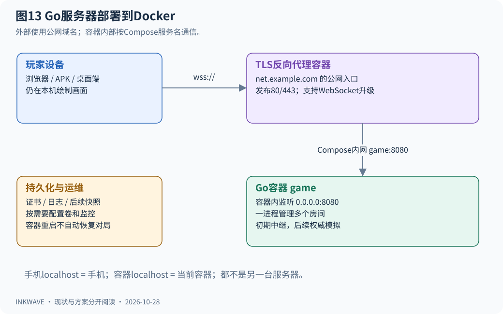

建议初版部署为一台Linux服务器、一个TLS反向代理容器、一个Go容器：

| 概念 | 新手理解 | 本项目中的用途 |
| --- | --- | --- |
| Go程序 | 真正干活的可执行文件 | 运行中继，后续运行权威模拟 |
| 镜像 image | 程序及运行材料的模板 | 固定构建产物，便于发布与回退 |
| 容器 container | 镜像启动后的运行实例 | 一个实例可管理很多房间 |
| Compose | 描述几个容器如何一起启动的配置 | 连接反向代理与Go |
| 反向代理 | 公网入口接待员 | TLS证书、域名、WebSocket升级转发 |
| volume | 容器外保存文件的位置 | 证书、以后明确需要持久化的内容 |

外部客户端使用例如 `wss://net.example.com/room/K7QXM`。代理在容器网络中访问 `game:8080`，Go监听容器内 `0.0.0.0:8080`；`game`是Compose服务名。**手机上的localhost指手机自己，容器里的localhost指当前容器自己**，都不能拿来表示另一台服务器。Compose容器间按服务名发现彼此，外部访问则用公网域名和发布端口。[Docker网络官方说明](https://docs.docker.com/compose/how-tos/networking/)。

下面仅用于理解端口关系，是**待实现配置片段**，当前仓库没有该Go程序、镜像、代理配置或 `--healthcheck` 子命令；不能复制后直接部署：

```yaml
services:
  proxy:
    image: your-registry/inkwave-proxy:release-id
    ports: ["80:80", "443:443"]
    # 代理配置 /room/* 转发至 game:8080，并支持 WebSocket。
    # TLS证书存储、域名和策略随选定代理补齐。
  game:
    image: your-registry/inkwave-server:release-id
    expose: ["8080"]
    environment:
      LISTEN_ADDR: "0.0.0.0:8080"
      ALLOWED_ORIGINS: "https://play.example.com,https://localhost"
    restart: unless-stopped
    stop_grace_period: 60s
    healthcheck:
      test: ["CMD", "/app/inkwave-server", "--healthcheck"]
      interval: 10s
      timeout: 3s
      retries: 3
```

这里的 `https://localhost` 仅示意APK内置资源来源，需要按实际Origin验证；正式白名单应同时考虑网页、APK、Electron的真实来源。Origin限制不是身份认证，未来账号/会话令牌要另做。Electron当前CSP的 `connect-src` 没有任意远端WSS放行项，接入新域名时要一并核对；APK也要核对网络配置，开发用明文ws不能直接当公网方案。

Go镜像可用多阶段构建：第一阶段编译，第二阶段仅放运行文件，不把整个编译器带进运行镜像。实际选定版本后固定镜像版本/摘要、使用非root用户，并带齐所需CA证书和地图数据。[Docker多阶段构建说明](https://docs.docker.com/build/building/multi-stage/)。WebSocket库及版本在实施时选择并固定，本文不预设第三方库已可用。

容器重启只会重启程序，**不会自动恢复内存中的房间、WebSocket或正在打的一局**。初期明确接受维护时结束房间；后期再设计令牌重连、完整快照和事件补发。部署更新可停止接新房并等待旧局结束，不能把60秒停止宽限期当成保证一场几分钟比赛打完。Go的 `http.Server.Shutdown` 不会自动等待/关闭WebSocket，需要应用单独管理长连接。[Go官方Shutdown文档](https://pkg.go.dev/net/http#Server.Shutdown)。

健康接口可分 `/healthz` 存活与 `/readyz` 是否可接新房。容器内置自检避免最小镜像没有curl；健康失败也不等于Compose必定自动重启，`restart`主要针对进程退出。需要启动顺序时使用健康依赖条件，但它仍不等于业务自动恢复。[Docker健康与启动顺序](https://docs.docker.com/compose/how-tos/startup-order/)。

## 15 分阶段改造 每一步怎样知道做对了

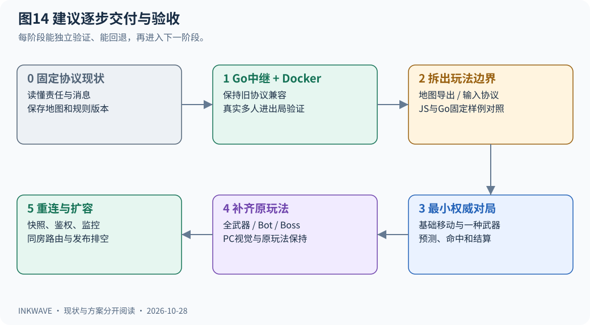

| 阶段 | 交付物 | 验收重点 | 回退方式 |
| --- | --- | --- | --- |
| 0 固定现状 | 协议清单、责任表、地图/规则版本约定 | 看清哪些是客户端权威，保留当前联机路径 | 只有文档，现有游戏保持 |
| 1 Go兼容中继 | 独立Go服务、Docker镜像与Compose | 建房/加入/锁房/选主、定向/广播、错误码、心跳和限流一致 | 客户端切回旧relay |
| 2 准备权威边界 | 明确的新协议、输入序号、地图导出、固定场景对照 | JS/Go碰撞和涂地计算样例一致；准备完成后才发令 | 新旧房间按模式隔离 |
| 3 最小权威对局 | 单地图、基础移动/武器、服务器时钟与伤害 | 两人输入预测/纠偏、延迟场景命中、事件不重复、统一胜负 | 返回旧中继模式 |
| 4 补齐原玩法 | 全武器/装置/Bot/Boss/区域控制 | 原玩法与PC视觉保持，每种模式完整进出局 | 保留已验收版本 |
| 5 运营与扩容 | 重连、快照、鉴权、指标、房间分配和发布排空 | 丢网/重启/跨实例路由/慢客户端与负载测试 | 固定镜像回退及明确房间丢失策略 |

第一阶段不要以“两个WebSocket连通”代替多人游戏验收。应覆盖：2人和8人、普通对战与Boss、进入结果再回大厅、房主/客机分别退出、冻结假活连接、错误协议版本、满房/锁房拒绝、慢发送队列，以及PC/手机混合加载。每轮检查位置、墨迹、血量、比赛状态和结果，必要时比对截图。

现有 `tools/net-test.mjs` 是可参考的联机测试框架，但当前硬编码macOS Chrome路径和Metal参数，Windows/Linux与Go测试入口要先适配；`--full` 的实际测试时长也按模式另设，不能照抄旧说明当成固定60秒。`tools/check-mobile-network.mjs` 是传输层模拟回归，不是公网多人实战证明。本次没有执行多人对局或部署Go服务。

容量也要实测。以8人每人20次广播为简化示例，中继每秒接收约160个tick负载，向其他7人转发约1120份；若每份假设1KiB，仅这些转发负载约1.1MiB/s，未计事件增长、协议开销和控制消息。它是算例而非本项目测量值。Go房间数量上限取决于负载、带宽、模拟和机器配置，Docker不会自动增加算力。

**适合你的第一步是Go兼容中继加Docker单机部署；长期目标是把Bot、Boss、碰撞、涂地规则和裁判逐项移入权威服。**先把“谁来计算、谁来确认、谁只负责画”划清楚，后面的技术选型才有明确依据。

## 16 结合实际游玩的常见问题

### 16.1 图里的Cloudflare服务是免费的吗

**有免费额度，可以免费起步，但不是无限免费。**按2026-10-28核对的官方价格，主要计算额度如下：

| 项目 | 免费额度 | 怎么理解 |
| --- | --- | --- |
| Worker入口请求 | 每天10万次 | 建立WebSocket的初始升级请求计入；不能把它等同于房间内每条消息 |
| Durable Object请求 | 每天10万次计费请求 | 包括连接请求、按规则折算的WebSocket消息、闹钟等 |
| Durable Object运行时长 | 每天13,000 GB·秒 | 按计费运行时间乘分配内存折算，不是玩家可玩13,000秒 |

这些是账号使用额度，不是每个房间分别赠送一份。免费计划超额后，相应操作会报错；并不是默认无限继续提供服务。免费Durable Object需使用SQLite后端，本仓库中继配置使用的正是该类型。[Durable Objects官方价格](https://developers.cloudflare.com/durable-objects/platform/pricing/)、[Workers官方价格](https://developers.cloudflare.com/workers/platform/pricing/)。

计费时，Durable Object入站WebSocket消息按20条折算1次请求，出站WebSocket消息不收请求费。假设8个人每秒各发送20次状态，持续玩一小时，仅这些状态消息的简化算式为：

```text
8人 × 20条/秒 × 3600秒 ÷ 20 = 28,800次计费请求
```

这是算例，不是实测账单；还没计连接、其他控制消息、闹钟、运行时长和存储等。多房间和长期开放需要看实际用量，不能只数建房次数；也不能因采用休眠API就认定高频战斗期间完全没有运行时长消耗。[官方WebSocket计费规则](https://developers.cloudflare.com/durable-objects/platform/pricing/#compute-billing)。

目前客户端默认连接原作者部署的中继，服务用量计入部署者的Cloudflare账号。仓库无法说明原作者当前套餐和剩余额度。未来自建Go服务时，则由自己承担机器、网络等运行成本；Docker只是部署方式，不赠送云端算力。

### 16.2 房主小明掉线 小红这局会结束吗

**只要中继和其他客户端仍正常，当前实现会尝试自动换房主，剩余玩家通常可以继续。**在“小明、小红、6个Bot”的例子中：

```text
中继发现小明离开
  → 选择仍在线、加入最早的成员，这里就是小红
  → 小红接管原来的6个Bot、比赛时钟和裁判职责
  → 小明的角色也接成Bot；Boss模式下还接管Boss
  → 其他客户端继续接收新房主的状态
```

切换期间可能看到角色暂时停住。正常关闭连接通常较快被发现；断网却没有正常关闭连接时，可能要等静默超时和清扫，当前比赛阈值20秒、清扫间隔4秒。`noBots`地图会移除离开角色，而不是补Bot。

接管从新房主已收到、显示着的状态继续，不是从云端精确恢复完整存档，因此不能保证交接完全无损。小明重新联网后，也没有自动恢复原角色继续战斗的完整重连流程。详见第8节与图8。

将来若由Go权威服持续运行Bot、Boss和裁判，某位玩家断线就不必把这些工作交给另一位玩家；但Go服务自己发生故障时，仍需要单独设计恢复方案。

### 16.3 小红不是房主 她打出的伤害在哪里计算

**攻击伤害由小红设备算出，实际扣血由目标所有者处理。**“目标所有者”不一定是房主。

| 小红打中谁 | 判断命中和算出攻击伤害 | 检查减伤并实际扣血 |
| --- | --- | --- |
| 房主小明 | 小红设备 | 小明设备，因为小明拥有自己的角色 |
| 另一位客机小蓝 | 小红设备 | 小蓝设备，不必交房主裁决 |
| Bot | 小红设备 | 房主设备，因为Bot归房主管 |
| Boss | 小红设备提出Boss命中请求 | 房主按Boss伤害规则处理 |

例如小红算出对小蓝造成30点攻击伤害，经过中继发给小蓝。小蓝会检查存活、队伍、无敌、护甲和其他减伤规则，再实际扣血或拒绝伤害。因此“发送30点伤害”不代表最终一定掉30血。

对应代码为 [weapons.js 的 applyHit](../src/game/weapons.js)、[netmatch.js 的 sendHit与_hit](../src/net/netmatch.js)、[actor.js 的 damage](../src/game/actor.js)。Boss请求另走 [boss.js 的 remoteHit](../src/boss/boss.js)，不能把普通玩家的所有减伤细节直接套到Boss身上。

### 16.4 小红会感觉打中了却过一会才扣血吗

**可能。本机射击反馈、目标实际扣血、攻击者收到击倒确认，是三个不同的时刻。**

```text
小红本机开火并显示弹道
  → 本机判断命中，发请求并可立即播放命中反馈
  → 经中继送到小蓝
  → 小蓝检查自身状态，实际扣血或拒绝伤害
  → 血量状态、击倒等信息再经网络传回
  → 小红看到后续状态或得到击倒确认
```

当前 `applyHit` 在发送远端命中请求后，就会派发本地 `hit` 反馈，此时并没有等待目标确认扣血。远端角色快照包含HP，击倒确认还有对应事件；具体界面怎样展示血量，应与网络状态是否已确认分开理解。

| 游玩现象 | 当前机制下的可能原因 |
| --- | --- |
| 枪口、射击声音立即响应 | 小红自己的设备直接处理，不等待网络批准 |
| 先有命中反馈，稍后才确认击倒 | 本地反馈先发生，目标扣血与确认需要网络传递和处理 |
| 看起来命中，但最后没掉血 | 目标端处于无敌等状态而拒绝；断线或处理延迟也需排查，不能仅凭画面确定原因 |
| 比预期掉血少 | 目标端还有护甲、减伤等规则 |

约0.1秒后才确认是合理的可能情况，**不是已经测出的固定延迟，也不是上限**。目标端扣血生效只需请求到达并处理；攻击者得知结果还需要返回传输，状态发送节拍、双方卡顿及事件显示时机也会影响体验，不能把这两段时间算成同一件事。

另外，小红看见的小蓝是经过插值缓冲、稍落后的远端画面。小红画面上还能命中，并不保证小蓝处理请求时仍处于相同状态；例如小蓝实际已进入重生无敌，就可能不扣血。当前不是由服务器拿统一历史战场回溯裁定。

未来Go权威服可以统一命中和伤害规则，但网络确认延迟仍然存在。改善手感需要分别处理本地预测反馈、权威确认、状态纠正，以及有限且经过校验的命中延迟补偿；仅换服务器语言不能自动消除延迟。上述说明为源码机制解读，本次未测量具体网络下的0.1秒延迟，也未执行多人对局。

## 附录 查代码时从这些入口开始

| 阅读顺序 | 文件 | 先找哪些内容 |
| --- | --- | --- |
| 1 | [原始英文联机契约](NET.md) / [原有中文翻译](NET.zh-CN.md) | API全貌；数值差异参考本文第4、8节 |
| 2 | [transport.js](../src/net/transport.js) | relayURL、connect、broadcast、sendTo、心跳 |
| 3 | [server/src/index.js](../server/src/index.js) | fetch、Room、webSocketMessage、_gone |
| 4 | [session.js](../src/net/session.js) | _connect、start、_begin、_go、endMatch |
| 5 | [netmatch.js](../src/net/netmatch.js) | _sendTick、_tick、applyRemote、_hit、_play、onLeave |
| 6 | [match.js](../src/game/match.js) / [boss.js](../src/boss/boss.js) | follower、_judge、remoteHit、pack、adopt |
| 7 | [paint.js](../src/world/paint.js) / [physics.js](../src/game/physics.js) | splat、CPU网格、coverage、raycast、胶囊碰撞 |
| 8 | [架构概览](ARCHITECTURE.zh-CN.md) / [墨水图解](INK.zh-CN.md) | 结合全局结构理解依赖 |

Cloudflare相关概念可继续看[官方WebSocket说明](https://developers.cloudflare.com/durable-objects/best-practices/websockets/)。这里的Go和Docker部分是待实施方案，不表示仓库已经有独立权威游戏服；实现现状以本仓库代码为准。
