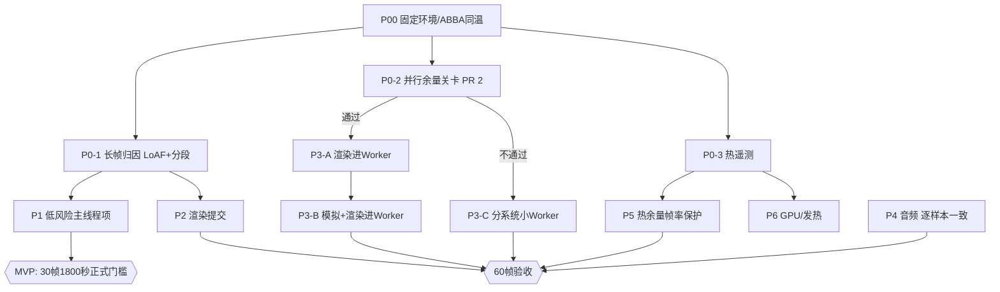

# Android Boss帧率优化计划：30帧稳定MVP → 60帧冲刺

> 本计划与仓库内 `docs/android/BOSS-60FPS-WORKPLAN.zh-CN.md`（P00～P06）对齐，不替代它；这里补充优先级、依赖、排期、业界做法、Android注意点和每项的 MVP / Plan B。
> 角色：**Claude**（代码 + 桌面/浏览器检查），**维护者**（Windows构建、签名、USB真机、ABBA同温对照）。
> 所有收益都是估计，以真机为准。规则不变：每项单独中文提交；正式门槛与Worker 3帧/250ms保护不放宽；不偷偷降2倍/SMAA/8人；有画面取舍的方案先说明差异，由用户决定。

## 0. 现状与目标

| 项目 | 数值 | 来源 |
|---|---|---|
| 30帧上限（v54，电池29→41°C，屏幕60Hz） | 旧/新/新/旧 29.69/29.67/29.65/29.55 FPS，P95均33.4ms，新旧差0.043不证收益 | test54 |
| 60帧上限 | 旧40.49/36.77、新39.70/36.39 FPS；热机P95约50ms；两版各9次≥100ms长帧 | OPUS-PERFORMANCE-60FPS-COMPARISON |
| 长帧样本 | 一帧119ms：模拟101.2ms、draw约5.2ms、UI约10.9ms；模拟中位约6.2ms，部分窗口P95 14.4ms | BOSS-60FPS-WORKPLAN §2.1 |
| 主线程构成（历史30秒V8） | `match.update`≈9.5ms/帧、渲染≈6.6ms/帧、`character.update`≈3.7ms/帧、HUD JS≈2.6ms/帧，另有样式/布局/绘制 | BOSS-MAIN-INVESTIGATION |
| 最大干扰 | 温度：44～46°C≈25～27FPS，47～49°C≈17～18FPS | 历史正式轮 |
| 已完成 | PR #1：小地图Worker超龄/暂停只停用并恢复、实战诊断暂缓落盘（v54真机暂停恢复 parks1/resyncs1/fallbacks0） | test54 |
| 进行中 | PR #2：渲染移入Worker可行性评估与并行余量方法轮（仅工具） | PR #2 |

**MVP（第一交付）**：Boss 30帧正式门槛：≥1800秒无探针，均值≥29.5FPS，P95≤36ms，P99≤50ms，≥100ms长帧0次；画面、玩法、8人、2倍、SMAA均不降级。
**冲刺目标**：60帧（WORKPLAN §2.3）：正式一分钟均值≥59FPS，P95≤18.5ms，P99≤33.4ms，≥100ms长帧0次。

诚实判断：
- 60帧热机目前约27ms/帧，距16.7ms预算差约10ms。
- P1+P2的低风险项估计合计约−2～−4.5ms，单靠它们达不到60。
- 量级足够的只有P3（并行架构）与P5（热余量）的组合。

## 1. 排期（压进度）

| 里程碑 | 日期 | 内容 | 出口条件 | 负责 | 状态 |
|---|---|---|---|---|---|
| M0 | 已完成 | W1/D1合入v54并经真机验证；PR #2关卡工具 | 远端与真机记录齐全 | Claude/维护者 | ✅ |
| M1 测量底座 | 10/28～10/31 | P0-1长帧归因、P0-2并行余量关卡、P0-3热遥测 | 长帧Top3分支已定位；关卡6轮完成并判定 | Claude写工具 / 维护者跑真机 | ⬜ |
| M2 MVP冲刺 | 11/01～11/07 | P1全部 → v55 → 30帧1800秒正式轮×2（ABBA同温） | MVP门槛通过，或给出差距与归因 | Claude实现 / 维护者验证 | ⬜ |
| M3 渲染提交 | 11/08～11/14 | P2（仅当M1证明CPU提交重） | 每项像素字节一致、方法轮有收益 | Claude / 维护者 | ⬜ |
| M4 并行架构 | 11/15～12/05 | 关卡通过走P3-A原型→产品化；不通过走P3-C | 主线程帧时间−4ms以上，PC不变 | Claude / 维护者 | ⬜ |
| M5 收尾与60帧验收 | 12/06～12/12 | P4音频、P5热、P6 GPU；60帧正式验收 | WORKPLAN §2.3全部通过，或记录“部分通过” | 全体 | ⬜ |

节奏要求：
- 每个工作日结束在本计划PR回帖：完成项、真机数据、阻塞、明日计划。
- 每项任务完成后勾选并贴提交号与报告文件名。
- 任一里程碑延期超过2天，回帖说明原因并给出新日期。

## 2. 依赖关系



## 3. 任务（按优先级）

### P0 测量底座（阻塞后续；M1）

- [ ] **P0-1 长帧归因（LoAF + 模拟分段）**｜依赖：P00｜Claude写工具，维护者跑真机｜1～2天
  - **为什么**：≥100ms长帧同时违反30帧和60帧门槛，P99由长尾决定；119ms样本中模拟占101ms，但还不知道是AI、物理、GC还是被抢占。
  - **业界做法**：Chrome 123+ 的 [Long Animation Frames API](https://developer.chrome.com/docs/web-platform/long-animation-frames) 能给出超过50ms的帧及其脚本级归因，比Long Tasks细；再配合 [Perfetto](https://perfetto.dev/docs/) 看调度、频率和抢占。
  - **Android注意**：
    - WebView 131≥123，理论上可用，需先真机确认 `PerformanceObserver.supportedEntryTypes` 含 `long-animation-frame`。
    - LoAF归因到脚本入口，函数级仍靠现有分段计时。
    - JS墙钟包含GC、被抢占和降频，必须同时采 sched/freq。
    - 禁止 `/json/protocol` 与详细Skia trace（会SIGTRAP）。
  - **MVP**：方法轮把每个≥50ms帧的LoAF脚本归因、模拟分段和GC/温度时间戳写进报告，定位Top3分支。
  - **Plan B**：LoAF不可用或归因为空时，用分段计时二分，加上V8 CPU profile短窗口（仅方法轮）。

- [ ] **P0-2 并行余量关卡（PR #2）**｜依赖：P00｜维护者跑6轮｜1天
  - **为什么**：Worker化要数周，要先证明这台受热限的手机上“另一核心并行承担负载时主线程不变慢”。
  - **业界做法**：[OffscreenCanvas + Worker](https://web.dev/articles/offscreen-canvas) 是官方推荐的主线程减负方式。
  - **Android注意**：
    - big.LITTLE/EAS调度无法从JS控制；Worker可能落在比X2慢的A710上。
    - 低占空比时核心会降频；把负载并行出去可能让整机升温。
  - **MVP**：
    - 30帧上限 `BOSS_WORKER_LOAD_MS=8/16/24` 与60帧上限 `BOSS_TEST_FPS=60` 的 `6/10/14`，各一轮，ABBA同温，配原生sched。
    - 通过条件：loaded窗口帧间隔劣化≤3%、P95劣化≤5ms；最高档 `skipped≈0`；`speedRatio≤1.4`；温升不高于基线轮。
  - **Plan B**：不通过则放弃整体Worker化，P3改走P3-C。

- [ ] **P0-3 热遥测（只读）**｜依赖：无｜Claude加只读原生方法｜0.5～1天
  - **为什么**：温度造成约±8FPS的波动，每轮必须记录才能做同温对照；P5也需要它。
  - **业界做法**：Android [ADPF Thermal API](https://developer.android.com/games/optimize/adpf/thermal) 的 `PowerManager.getThermalHeadroom(forecastSeconds)`（Android 11+）预测当前负载还能维持多久，官方建议游戏据此降低工作量，例如降帧率、降保真度或移到小核。
  - **Android注意**：
    - 低频轮询（≥1秒），部分设备有最小调用间隔或返回NaN。
    - 只读，不修改热策略、不root、不用反射（仓库规则）。
    - 在已有 `BossDisplay` 插件上加只读方法，失败容错。
  - **MVP**：每秒样本带 `thermalHeadroom` 与 `thermalStatus`。
  - **Plan B**：不支持时只记 `getCurrentThermalStatus()` 和电池温度，并标注“非SoC温度”。

### P1 低风险主线程项（MVP主力；M2，可并行开发，按P0-1结果排序）

- [ ] **P1-1 角色纯视觉层每帧一次（C1）**｜依赖：P0-1｜Claude｜2天｜估计−0.5～−0.9ms/帧（仅30帧上限）
  - **为什么**：30帧上限下 `dt>1/45`，物理子步固定为2（main.js:1482），8个角色的脸、头发、材质/rim、LOD、抖动每帧算两遍。
  - **业界做法**：固定步长模拟加每渲染帧一次表现层更新（[Fix Your Timestep](https://gafferongames.com/post/fix_your_timestep/)）；表现层不参与物理。
  - **Android注意**：
    - 60帧上限时 `dt≤1/45` 只有1个子步，这项对60帧没有收益，只服务MVP。
    - 头发弹簧要用合并后的dt保持数值稳定。
    - 根运动、状态、脚步、IK、武器、事件仍每子步执行。
  - **MVP**：只移动脸/头发/材质/rim/LOD/抖动，种子回放事件与枪口日志逐位一致，延迟骨骼角度≤1°。
  - **Plan B**：只移动材质和uniform写入（最安全的一半）。

- [ ] **P1-2 Boss视觉层每帧一次（B1）**｜依赖：P1-1方法｜Claude｜1天｜估计−0.1～−0.5ms/帧
  - **为什么**：`bossAnim` 的链条、FX、`updateMatrixWorld(true)` 每子步都执行（bossAnim.js:604-608）。
  - **业界做法**：同P1-1。
  - **Android注意**：
    - Boss的10个命中球由骨骼 `matrixWorld` 构建，必须仍每子步更新姿态与命中形状。
    - 只移链条、FX和uniform。
  - **MVP**：命中/伤害日志逐位一致。
  - **Plan B**：只移FX与uniform。

- [ ] **P1-3 帧循环零分配（G1）**｜依赖：P0-1｜Claude｜1～2天｜估计−0.1～−0.3ms/帧，并减少GC尖峰
  - **为什么**：GC约0.5ms/帧，且可能是长帧来源。热路径存在每帧新建对象和闭包：main.js:1689-1755、match.js:326、hud-boss.js:348、actor.js:448、bots.js。
  - **业界做法**：V8 [Orinoco](https://v8.dev/blog/trash-talk) 新生代回收虽然并行，主线程仍需暂停；游戏循环通行做法是对象池和数组复用。
  - **Android注意**：降频核上GC暂停更长，需用LoAF/trace确认长帧是否与GC重合。
  - **MVP**：帧循环、HUD、match热路径零分配。
  - **Plan B**：只修分配量Top5的点。

- [ ] **P1-4 涂地“+N”弹出不再强制布局（H1）**｜依赖：P0-1｜Claude｜0.5天｜估计−0.1～−0.4ms/帧，弹出帧−1～−4ms
  - **为什么**：hud.js:1844/2175 用 `void el.offsetWidth` 强制同步布局，并每次新建span。
  - **业界做法**：避免 [layout thrashing](https://web.dev/articles/avoid-large-complex-layouts-and-layout-thrashing)；用Web Animations API或双关键帧切换重启动画；节点池化。
  - **Android注意**：
    - 样式/布局与JS同在主线程。
    - v48做过同类改动但数据被W1整局回退污染，必须在无park的轮次重测。
  - **MVP**：外观逐帧一致（动画曲线、时长不变）。
  - **Plan B**：只做节点池，保留原重启方式。

- [ ] **P1-5 HUD杂项（H2）**｜依赖：P0-1｜Claude｜0.5天｜估计−0.1～−0.3ms/帧
  - **为什么**：
    - 透明度为0时盾牌SVG旋转、Boss条星星（带两层drop-shadow）仍在动画。
    - 非本人小地图点的键包含朝向，导致重写。
    - 队友头部矩阵每帧重算。
  - **业界做法**：[只动合成器属性、控制图层数量](https://web.dev/articles/stick-to-compositor-only-properties-and-manage-layer-count)；不可见元素停动画。
  - **Android注意**：
    - 历史“动画接管”（v38～v39）已撤回，不要重做。
    - 这里只处理不可见元素，复用已有 `iw-mobile-boss-decor` 类。
  - **MVP**：可见画面字节一致。
  - **Plan B**：只做小地图点键与头矩阵两项。

- [ ] **P1-6 空实例池不提交、实例缓冲按段上传（R1）**｜依赖：无｜Claude｜1天｜估计−0.1～−0.4ms/帧
  - **为什么**：空的fx/weapons/bow/mitts/torpedo池仍有绘制准备；`weapons.js:2156` 的700实例blob每帧整段上传（64KB）。`bossModelFx.js:198` 已有正确写法 `visible = live > 0`。
  - **业界做法**：three.js `BufferAttribute.addUpdateRange` 只上传脏段；计数为0时不进入渲染列表。
  - **Android注意**：
    - 部分移动驱动对 `bufferSubData` 局部更新可能产生隐式同步。
    - 需在真机方法轮比较“整段上传”与“局部上传”的draw墙钟后再定。
  - **MVP**：先只做 `visible = count > 0`。
  - **Plan B**：保持整段上传，只跳过空池。

- [ ] **MVP验收**：v55构建（记录版本/源码/SHA-256/签名），30帧1800秒正式轮×2，ABBA同温。｜依赖：P1全部｜维护者

### P2 渲染提交（M3；只有P0-1证明CPU提交重才做）

- [ ] **P2-1 手机不透明物体按程序/材质分组（R2）**｜Claude｜2天｜估计−0.2～−0.5ms/帧
  - **为什么**：角色材质按角色区分、按材质id排序，导致几乎每次角色绘制都切换程序（character.js:667-677）。
  - **业界做法**：按着色器/材质排序减少状态切换；缓存getter，避免同步查询（[MDN WebGL best practices](https://developer.mozilla.org/en-US/docs/Web/API/WebGL_API/WebGL_best_practices)）。
  - **Android注意**：
    - WebView的GL调用经应用进程内GPU线程的命令缓冲，状态切换同时消耗主线程与GPU线程。
    - 排序改变可能影响深度/透明结果，必须用现有3视角冻结工具做字节对比。
  - **MVP**：只对不透明角色身体部位分组。
  - **Plan B**：不改排序，只合并同材质的uniform写入。

- [ ] **P2-2 共享骨骼纹理（R3）**｜Claude｜3天｜估计−0.15～−0.35ms/帧
  - **为什么**：9个骨架每帧各上传一次骨骼纹理。
  - **业界做法**：多实例共享一张骨骼纹理，加每骨架偏移。
  - **Android注意**：需改three.js shader chunk，升级three时有维护成本；纹理尺寸受 `MAX_TEXTURE_SIZE` 限制。
  - **MVP**：只对8个角色共享。
  - **Plan B**：放弃，保留原上传。

- [ ] **P2-3 不绘制的叶骨与静态根（R4）**｜Claude｜1～2天｜估计−0.1～−0.25ms/帧
  - **为什么**：约560根可见但不绘制的骨骼仍被遍历。这与已否决的“隐藏LOD”不同，那次移除的是网格。
  - **业界做法**：three.js对静态物体关闭 `matrixAutoUpdate`（官方“[Optimize lots of objects](https://threejs.org/manual/#en/optimize-lots-of-objects)”思路）。
  - **Android注意**：玩法会读取枪口、手、头骨骼和Boss命中球，这些必须保持更新。
  - **MVP**：只处理确认无挂载的叶骨。
  - **Plan B**：只处理静态根。

### P3 并行架构（M4；依赖P0-2）

- [ ] **P3-A 渲染进Worker（OffscreenCanvas）**｜依赖：P0-2通过｜Claude为主｜2～3周｜估计主线程净−4～−8ms/帧
  - **为什么**：渲染JS约6.6ms/帧，另有GL命令编码；真实Boss场景只有1273对象、111次绘制，每帧同步约100～220KB，搬得动。详见PR #2文档。
  - **业界做法**：
    - `canvas.transferControlToOffscreen()` 后在Worker里跑three.js（[web.dev](https://web.dev/articles/offscreen-canvas)、[Evil Martians实践](https://evilmartians.com/chronicles/faster-webgl-three-js-3d-graphics-with-offscreencanvas-and-web-workers)）。
    - 每帧状态用 [Transferable](https://developer.mozilla.org/en-US/docs/Web/API/Web_Workers_API/Transferable_objects) 零拷贝转移。
    - 共享内存需要 [COOP/COEP跨源隔离](https://web.dev/articles/coop-coep) 才能用SharedArrayBuffer。
  - **Android注意**：
    - Capacitor从 `https://localhost` 本地服务加载，要用SAB须在原生侧给响应加COOP/COEP头，否则只能每帧transfer。
    - 必须先拆掉8处同步耦合：
      1. 涂墨图集在模拟中途绘制，改为发splat事件；
      2. 镜头FX；
      3. LOD由 `onBeforeRender` 回写，以及战斗中的 `warmAll` 回退；
      4. 每帧 `mobileGpu.recover`；
      5. 玩法读取骨骼/相机矩阵，主线程需自行 `updateMatrixWorld`；
      6. DOM来源纹理改OffscreenCanvas/ImageBitmap；
      7. 尺寸/DPR改为传值并 `setSize(...,false)`；
      8. 现有测试工具都改为Worker侧仪表。
    - 涂墨图集必须与关卡材质在同一GL上下文，只能随渲染器一起进Worker。
    - PC保持原路径。
  - **MVP**：Boss场景渲染（含涂墨图集事件化、合成、SMAA）进Worker，HUD/小地图/音频留在主线程；方法轮主线程帧时间下降≥4ms，像素字节一致。
  - **Plan B**：P3-C。

- [ ] **P3-B 模拟+渲染进Worker**｜依赖：P3-A成功｜月级｜60帧唯一量级足够的方案
  - **为什么**：主线程只剩HUD与DOM，约8～10ms；游戏约20～24ms在另一核心并行。
  - **业界做法**：同P3-A；HUD改为读取每帧状态快照。
  - **Android注意**：
    - 数百模块的 `window`/`document`/`localStorage`/Capacitor访问需要代理。
    - 音效事件跨线程会有不超过1帧的排程误差，与“声音一致”约束冲突，需用户决定。
    - 必须保持PC双架构。
  - **MVP**：Boss模式单独走Worker入口。
  - **Plan B**：停在P3-A，靠P5热余量和P1/P2争取60。

- [ ] **P3-C 自包含子系统Worker**｜依赖：无（P3-A失败时为主线）｜每项2～4天｜每项约−0.5～−2ms
  - **为什么**：`fx.js` 只依赖three和config，不写玩法状态，可由生成事件驱动；涂墨splat处理也可以拆出。
  - **业界做法**：参照已上线的小地图Worker（有界在途、主循环顺序应用、超龄回原同步路径）。
  - **Android注意**：每个Worker都要有超龄保护和停用恢复（同PR #1机制），并且不能在战斗中首次分配大数组。
  - **MVP**：先做 `fx.js` 粒子模拟。
  - **Plan B**：保持主线程实现。

### P4 音频（M5；约束：声音逐样本一致）

- [ ] **P4-1 Boss音乐分层离线预渲染**｜依赖：P0-3｜Claude｜3～5天｜估计≤6%单核，FPS收益可能测不出
  - **为什么**：音频线程曾占71～89%单核；整图旁路降到约17%，但上限约+2FPS；停音乐只降约6点。
  - **业界做法**：
    - 卷积、HRTF、压缩器是Web Audio里最贵的节点（[W3C讨论HRTF成本](https://lists.w3.org/Archives/Public/public-audio/2013JulSep/1116.html)、[卷积缓冲上限问题](https://www.w3.org/2011/audio/track/issues/73)）。
    - 共享混响总线；用OfflineAudioContext预渲染确定性内容。
  - **Android注意**：
    - Chromium卷积的前段固定在实时线程，缩短IR不降实时线程负载（短IR已上线、实测无效）。
    - 音乐是自适应的（3阶段、强度层、小节同步切换），总线压缩器必须保持实时。
    - 需要10～40MB内存并延长加载时间。
  - **MVP**：只预渲染一阶段满强度层，逐样本对比。
  - **Plan B**：用户批准“同配方非逐样本一致”的方案，例如扩大单发缓存，逐项试听A/B。

### P5 热与平台（M5；依赖P0-3）

- [ ] **P5-1 60帧冲刺的热余量帧率保护**｜Claude + 维护者｜2天
  - **为什么**：热机时帧率掉到17～27FPS；60帧版本在热机时比稳定30更差。
  - **业界做法**：ADPF Thermal API官方建议余量不足时降帧率。
  - **Android注意**：
    - 这里只切帧率上限（60↔30），不降画质，不改2倍/SMAA。
    - 需加迟滞（例如headroom>0.85切30、<0.7才回60），避免抖动。
    - 需要用户批准。
  - **MVP**：设置项“60帧（过热自动回30）”，默认仍30。
  - **Plan B**：固定30（即MVP）。

- [ ] **P5-2 ADPF性能提示**｜结论：**不做**
  - Chromium/WebView的ADPF只对SoC厂商白名单启用，默认只有“Google”（[viz features.cc](https://chromium.googlesource.com/chromium/src/+/HEAD/components/viz/common/features.cc)）。本机是高通，不在白名单内。
  - 游戏主线程在WebView沙箱渲染进程里，应用拿不到它的线程ID去提示。

- [ ] **P5-3 显示刷新率**｜结论：**暂不做**
  - 刷新率行为不稳定：test36中实战请求60Hz、实际仍120Hz，v54轮次却是60Hz。
  - `View.setRequestedFrameRate` 需要API 35，本机是API 34。参考[Android帧率指南](https://developer.android.com/media/optimize/performance/frame-rate)。

### P6 GPU与发热（M5；依赖P0-3显示热量主导）

- [ ] **P6-1 涂墨干燥按脏块处理、去掉未用深度缓冲、合并Grade+ScreenFX、invalidateFramebuffer**｜Claude｜3～4天｜只降GPU时间与发热
  - **为什么**：干燥pass覆盖整个已用区域，mipmap几乎每帧生成，存在未用的深度缓冲（paint.js:390-449/844，renderer.js:130/190/211）。
  - **业界做法**：移动端分块（tile-based）GPU应减少全屏pass，对不再需要的附件 `invalidateFramebuffer` 以避免回写；渲染循环中避免同步查询（[MDN](https://developer.mozilla.org/en-US/docs/Web/API/WebGL_API/WebGL_best_practices)）。
  - **Android注意**：
    - Adreno 730是分块GPU。
    - 每项都必须像素字节一致，RG8之类有差异的格式已被否决。
  - **MVP**：先做 `depth:false` 与合并pass。
  - **Plan B**：只做干燥脏块。

## 4. MVP / Plan B 总表

| 目标 | MVP路径 | 若失败的Plan B |
|---|---|---|
| 30帧正式门槛 | P0-1归因 → P1全部 → v55 1800秒×2 | P2补渲染提交；仍不过则P3-C搬fx；温度主导时加P6降GPU发热 |
| 60帧冲刺 | P0-2通过 → P3-A → P3-B + P5-1 | P3-C + P2 + P5-1，交付“60帧（过热回30）”选项，并如实记录“部分通过” |
| 音频减负 | P4-1逐样本一致预渲染 | 用户批准的同配方方案，逐项试听 |
| 长帧0次 | P0-1定位 + P1-3零分配 | 加载期预分配/预热；对剩余长帧逐个归因并留档 |

## 5. 每日回帖模板

```
日期：
完成：[任务ID] 提交号 / 报告文件
真机：版本、源码、FPS/P95/P99/≥100ms、起止温度、thermalHeadroom
阻塞：
明日：
```

## 6. 参考
- 仓库内：`docs/android/BOSS-60FPS-WORKPLAN.zh-CN.md`、`docs/android/BOSS-PERFORMANCE-test54.zh-CN.md`、`docs/android/OPUS-PERFORMANCE-60FPS-COMPARISON.zh-CN.md`、`docs/android/BOSS-WORKER-RENDER-FEASIBILITY.zh-CN.md`（PR #2）
- Long Animation Frames API：https://developer.chrome.com/docs/web-platform/long-animation-frames
- Perfetto：https://perfetto.dev/docs/
- Android ADPF Thermal API：https://developer.android.com/games/optimize/adpf/thermal
- OffscreenCanvas：https://web.dev/articles/offscreen-canvas
- three.js + OffscreenCanvas实践：https://evilmartians.com/chronicles/faster-webgl-three-js-3d-graphics-with-offscreencanvas-and-web-workers
- Transferable objects：https://developer.mozilla.org/en-US/docs/Web/API/Web_Workers_API/Transferable_objects
- COOP/COEP：https://web.dev/articles/coop-coep
- WebGL best practices：https://developer.mozilla.org/en-US/docs/Web/API/WebGL_API/WebGL_best_practices
- Fix Your Timestep：https://gafferongames.com/post/fix_your_timestep/
- V8 GC（Orinoco）：https://v8.dev/blog/trash-talk
- 避免布局抖动：https://web.dev/articles/avoid-large-complex-layouts-and-layout-thrashing
- 合成器属性与图层：https://web.dev/articles/stick-to-compositor-only-properties-and-manage-layer-count
- Chromium ADPF开关与SoC白名单：https://chromium.googlesource.com/chromium/src/+/HEAD/components/viz/common/features.cc
- Android帧率：https://developer.android.com/media/optimize/performance/frame-rate
